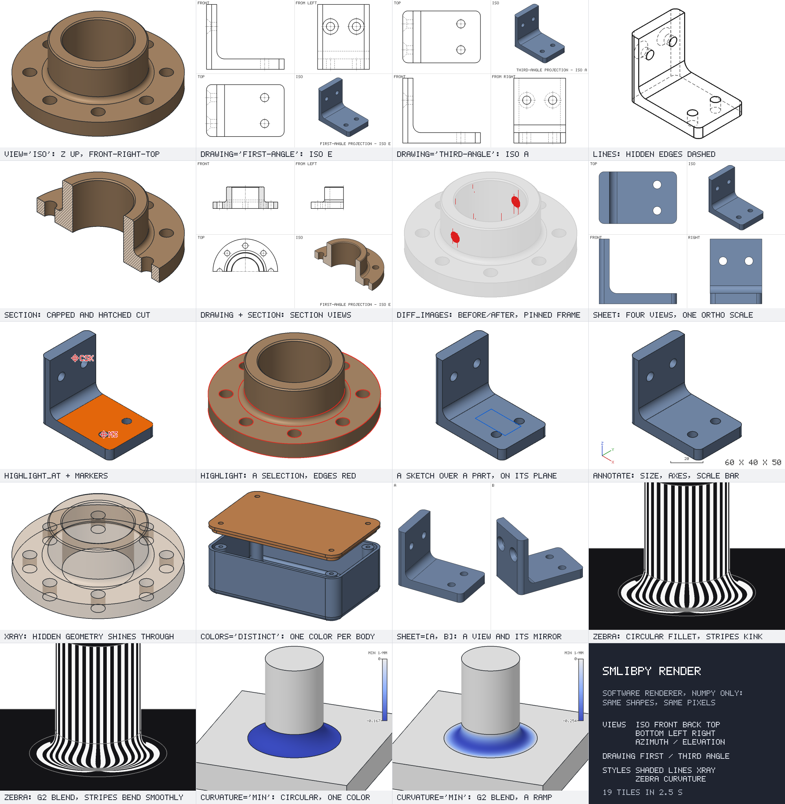

<picture><source media="(prefers-color-scheme: dark)" srcset="docs/readme/frontispiece.dark.svg"></picture>

# smlibpy

A Python library for 3D modeling on the [SMLib NURBS kernel](https://github.com/NVIDIA-Omniverse/usd-brep). The API follows the style of [build123d](https://github.com/gumyr/build123d)'s algebra mode and shares a few ideas with [CadQuery](https://github.com/cadquery/cadquery), but not its method chains: shapes are plain values, and every operation returns a new one.

It comes with an MCP server, so your agent can build parts too. And it runs in the browser:
[smlibwasm](#in-javascript) is the same library for JavaScript and TypeScript, on the kernel compiled
to WebAssembly, and [smlibpy-three](#in-threejs) is it for three.js.

**[Website](https://smlibpy.classcad.ch)** · **[Documentation](https://smlibpy.classcad.ch/docs/)** ·
**[Getting started](https://smlibpy.classcad.ch/docs/getting-started)** · **[API reference](https://smlibpy.classcad.ch/docs/api)** ·
**[For agents](https://smlibpy.classcad.ch/docs/mcp)** · **[JavaScript](https://smlibpy.classcad.ch/docs/javascript)**

```python
from smlibpy import *

plate = Box(80, 60, 10)
plate = plate.fillet(plate.edges().parallel_to(Z), 8)
plate -= GridLocations(60, 40, 2, 2) * Cylinder(4, 10)
plate -= Rectangle(30, 20).on(plate.faces().top()).extrude(-4)

plate.export("plate.step")
show(plate)
```

Parts are B-reps with exact surfaces: planes, cylinders, cones, spheres, tori and NURBS.
Volumes, areas and inertia are integrated over those surfaces, and STEP files keep them as they
are. You combine shapes with `+`, `-` and `&`, and every feature returns a new part. Faces and
edges are picked by their geometry, for example `part.faces().top()` or
`part.edges().parallel_to(Z).concave()`. The plate above builds in about 40 ms. The
[concepts](https://smlibpy.classcad.ch/docs/concepts) explain shapes, planes, locations and selections.

## Features

**Modeling** ([parts](https://smlibpy.classcad.ch/docs/parts), [features](https://smlibpy.classcad.ch/docs/features))
- Primitives: `Box`, `Cylinder`, `Cone`, `Sphere`, `Torus`, `Wedge`, `Pyramid`, sectors of them
  (`arc_size=`) and `AnnularSector`
- Holes: `Hole`, `CounterBoreHole`, `CounterSinkHole`, placed with `Locations`, `GridLocations`,
  `PolarLocations`, `HexLocations`
- Booleans: `fuse`, `cut`, `intersect`, which can also be written `+`, `-`, `&`; `merge` makes one
  part of several cells (as for several materials), `cells()` gives them back, named after the
  parts they lie in; `imprint` splits faces where a tool crosses them; `split` by planes and sheets
- Operations: `extrude` (also tapered, with plane walls), `revolve`, `swing` (a revolve around any
  outline), `loft` (also with end tangents, closed, or of open sections along rails), `sweep` (the
  profile's attitude, a twist and a scale along the path; along helices without rolling; an open
  profile from the path to a second rail), `shell` (walls of their own thickness, round or sharp
  corners), `offset` (sharp or round), `thicken`, `draft`, `mirror`, `split`, `section`
- Direct editing: `move_faces` and `offset_faces` move and push-pull faces, resize holes and
  bosses, and rebuild the part around them exactly
- Fillets: circular, variable radius, and curvature-continuous (G2/G3), along tangent runs, with
  mitred or set-back corners; chamfers with one or two setbacks or an angle, exact cones on round
  edges

**[Sheet metal](https://smlibpy.classcad.ch/docs/sheet-metal)**
- `fold` and `flange` with exact bends (radius and K-factor, kept per bend; K-factor rules such as
  DIN 6935)
- `unfold`, and `flat_pattern` with bend lines and an outline of lines and arcs; rolled parts,
  curls and bends over 180 degrees too
- `bends()`, `bend_allowance`, `bend_deduction`, `developed_length`

**[Deformation](https://smlibpy.classcad.ch/docs/deform)**
- `twist`, `taper` and `bend` work on finished parts, and on edges, wires and points. A tapered
  cylinder becomes an exact cone, a plate bent by up to 90 degrees exact cylinders (sheet metal
  you can unfold).
- `unroll` lays a part wrapped around an axis out flat
- Free-form deformation with a `Lattice`

**Simplifying:** `remove_fillets` and `remove_faces` take out fillets, holes and bosses, also on
imported parts. `faces().fillets()` finds the fillet faces.

**Molding:** `draft` tilts walls, pockets and holes by a draft angle about a neutral plane.
`draft_analysis` sorts each face for a pull direction into positive, insufficient, vertical or
undercut. `parting_line` finds the parting line.

**2D** ([sketches](https://smlibpy.classcad.ch/docs/sketches))
- `Profile` is a pen: it draws lines and tangent arcs, turns, and adds fillets and chamfers at
  corners as it goes.
- Shapes: `Rectangle`, `RoundedRectangle`, `Circle`, `Ellipse`, `Polygon`, `RegularPolygon`,
  `Triangle`, `Trapezoid`, `Slot`, `ArcSlot`, `Hull`, and `Stroke` (a band along a path). The
  polygon shapes take `fillet=` and `chamfer=`.
- Exact 2D Booleans, offsets, and corner fillets and chamfers (also at splines and ellipses).
  Sketches can be extruded, revolved, swung and swept, and know their section properties.
- `Text` with exact font outlines (the Lato font is included)

**[Curves and surfaces](https://smlibpy.classcad.ch/docs/surfaces)**
- Curves: `Line`, `Polyline`, `PolarLine`, `CenterArc`, `ThreePointArc`, `RadiusArc`,
  `SagittaArc`, `TangentArc`, `EllipticalArc`, `ParabolicArc`, `HyperbolicArc`, `ConicArc`,
  `Spline`, `Bezier`, `Helix` (any number of turns), `Spiral`, `FilletPolyline`, `fit_curve`
  (a smooth curve near noisy points, within a tolerance); trim, split, extend, join, offset,
  `to_arcs` (lines and arcs for CNC), curvature and inflections, `through` and `match` to bend an
  edge; their NURBS data (`nurbs()`, `Edge.from_nurbs`), `make_compatible`, `remove_knots`
- Surfaces: `surface` through a grid of points or fitted to a cloud of points (a scan, with a
  report of the distances), `nurbs_surface`, `ruled`, `surface_fillet` (a round or chamfer between
  two sheets), `blend` (a G1/G2/G3 bridge between sheet edges), `fill` and `network` (patches in
  loops of curves, surfaces through curve networks), `trim`, `extended`, `push`, `warp` and
  `flatten` (local edits of a face), `match_edge`, `merge_faces`, `stitch` (faces into a solid,
  within a tolerance, with a report), `to_nurbs`; curves on faces (`Face.project`, `wrap`, `iso`)

**[Selection](https://smlibpy.classcad.ch/docs/selecting)**
- By position (`top()`, `bottom()`, `nearest()`, …), by size (`largest()`, `smallest()`), and
  by geometry (`lines()`, `circles()`, `planar()`, `cylinders()`, `parallel_to()`, `facing()`,
  `convex()`, `concave()`, `fillets()`, …)
- `filter_by`, `sort_by`, `group_by`, set operators between lists, and `neighbors()` of a face
- By history: `new()`, `derived_from()` (the faces and edges an operation made, or that come from
  a body), `joining()` (where two bodies meet), `tangent_chain()`; continuity (`g1()`, `g2()`)
- Colors and names of single faces; shells, cavities (`voids()`) and the cells a face bounds
- `hit_by()`: the faces a ray meets, nearest first

**[Measuring and checks](https://smlibpy.classcad.ch/docs/analysis)**
- `volume`, `area`, `center` and `mass_properties` (inertia, principal axes), computed from the
  exact surfaces to seven significant digits, with an error estimate
- `distance_to` and `closest_points` between bodies, faces and curves, `classify` (inside, outside
  or on), `raycast` and `raycast_many`, `intersection_curves`, `silhouette`, `project`, `outline`
  with hidden lines, curvature of faces and edges, continuity across edges, edge radius and
  convexity, section properties of sketches
- `is_valid`, `check()` (what the kernel's own check finds, by face, edge or vertex) and `heal()`.
  Every kernel result is checked, and a fillet or shell that can't work raises an error that says
  what would fit, and where.

**[Files](https://smlibpy.classcad.ch/docs/files)**
- STEP in and out: exact geometry, assemblies (a product per body), units, names and colors, also
  of single faces (`named()`, `colored()`); coordinate systems, curves and points in and out
- IGES in: solids and trimmed surfaces (stitched into solids), exact surfaces and curves, units,
  names and colors
- USD in and out: exact bodies as the `BrepArray` prims of NVIDIA's usd-brep (Omniverse), with
  names, colors and materials, placed as the stage places them; meshes for plain viewers
- OpenCASCADE `.brep` in and out (build123d, CadQuery, FreeCAD): exact bodies
- DXF in and out with exact arcs and splines (or lines and arcs only); SVG out; STL in and out;
  glTF/GLB and OBJ out
- SMLib's own formats (`save`, `load`): `.smb` for one body, `.smp` part files for several bodies
  and curves with names and colors
- Every format also to and from memory (`to_step`, `from_step`, ...)

**[Meshes](https://smlibpy.classcad.ch/docs/analysis)**
- Booleans of meshes (`+`, `-`, `&`), also of STL files; `decimate`, sections and slices,
  `fill_holes` and `repaired`, faceted parts from closed meshes, mass properties, many rays at once

**[Pictures](https://smlibpy.classcad.ch/docs/files)**
- `render()` needs no GPU or browser:
  - shaded views, and sheets of 2 or 4 views
  - technical drawings in first-angle (ISO E) or third-angle (ISO A) projection, with dashed
    hidden lines and center lines
  - sections, x-ray, highlights, markers, a measurement overlay, zebra stripes and curvature
    maps
- `drawing_views` lays out the views of a part with exact visible and hidden lines, for SVG and
  DXF (layers VISIBLE and HIDDEN).
- `diff_images` compares two renders.
- `show()` opens a 3D viewer in the browser or a notebook.

**[Agents](https://smlibpy.classcad.ch/docs/mcp)**
- The MCP server `smlibpy-mcp` shows the session live in Buerligons, where what you select reaches
  the agent; it has snapshots, function search and a tested guide
  for every function. People who want parametric apps that rebuild from sketches and features
  are sent to the [ClassCAD](https://classcad.ai) MCP.
- A Claude Code plugin, installed from this repository (see below)

## Install

```bash
pip install smlibpy
```

There are wheels for Linux (x86_64, aarch64), macOS (arm64, x86_64) and Windows, for Python
3.10 to 3.15, with the kernel compiled in. They are 8 to 11 MB, and numpy is the only
dependency. For agents, `pip install "smlibpy[mcp]"` adds the MCP server; see
[AI agents](https://smlibpy.classcad.ch/docs/mcp).

To build from source you need CMake and a C++17 compiler (about a minute on a laptop):

```bash
git clone --recursive https://github.com/awv-informatik/smlibpy
cd smlibpy
pip install .
```

## For agents

The MCP server lets Claude and other agents model with smlibpy. In Claude Code:

```bash
claude plugin marketplace add awv-informatik/smlibpy
claude plugin install smlibpy@smlibpy
```

Other hosts start `uvx --from "smlibpy[mcp]" smlibpy-mcp`; see [AI agents](https://smlibpy.classcad.ch/docs/mcp). The
agent works in four steps:

1. A skill tested on the real kernel: every function has a guide, written by agents that ran
   each call and wrote down what they found. The server hands the guides out, and its search
   knows CAD synonyms.
2. One script per step: the agent writes a whole step as a Python script and runs it. The
   session keeps the model between scripts; a kernel crash costs a restart, and the session is
   rebuilt from the scripts that made it.
3. A renderer to look with: `snapshot` draws the model in software, as technical drawings with
   hidden lines, sections, x-ray, highlighted selections, markers, zebra stripes or curvature
   maps.
4. Loops until it is right: after every step the agent checks numbers and pictures, fixes what
   is off, compares before and after on a pinned frame, and goes back to a checkpoint when a
   step fails.

<p align="center"></p>

## In JavaScript

smlibwasm (`@classcad/smlibwasm` on npm) is smlibpy for JavaScript and TypeScript: the same API on
the same kernel, compiled to WebAssembly. It runs in the browser and in Node, without a server and without dependencies.

```bash
npm install @classcad/smlibwasm
```

```js
import { Box, Cylinder, GridLocations, Z, toStep } from '@classcad/smlibwasm'

let plate = Box(80, 60, 10)
plate = plate.fillet(plate.edges().parallelTo(Z), 8)
plate = plate.cut(GridLocations(60, 40, 2, 2).mul(Cylinder(4, 10)))
const step = toStep(plate) // the STEP file as text
```

Names are camelCase, keyword arguments become an options object, and operators become methods
(`a.cut(b)` for `a - b`). `@classcad/smlibwasm/worker` runs models in a Web Worker with timeouts. A
browser loads about 2.9 MB with brotli: 2.2 MB for the kernel (`smlibwasm.wasm`, 9.4 MB
uncompressed) and 0.6 MB for the library, its font and the dictionary of WOFF2 fonts. The
[JavaScript docs](https://smlibpy.classcad.ch/docs/javascript) have the sizes, examples for the browser and the whole API in
TypeScript; the source is in [`js/`](js).

## In three.js

smlibpy-three (`@classcad/smlibpy-three` on npm) is smlibwasm's API for three.js: parts, sketches,
faces, edges and curves are three.js objects (a part is a `THREE.Mesh`), in three's coordinates and
with three's geometry arguments (`new Box(80, 10, 60)` is `BoxGeometry(80, 10, 60)`), and three's
Raycaster picks the exact faces and edges.

```bash
npm install @classcad/smlibpy-three three
```

Its README has the API and how it maps to three; the source is in [`smlibpy-three/`](smlibpy-three).

## A short tour

### [Sketches](https://smlibpy.classcad.ch/docs/sketches)

Sketches are 2D regions. Place them on a plane or a face, then extrude, revolve, loft or sweep
them.

```python
profile = Polygon((25, 0), (60, 0), (60, 12), (35, 12), (35, 40), (25, 40))
flange = profile.on(Plane.front).revolve(Z)
flange -= PolarLocations(47.5, 8) * Cylinder(5, 30)
```

### Text

Lettering is a sketch with the exact outlines of a font; `size` is the height of the capitals.

```python
tag = Box(60, 20, 3)
tag -= Text("SMLIB 01", 8).on(tag.faces().top()).extrude(-0.5)
```

### [Selecting edges and faces](https://smlibpy.classcad.ch/docs/selecting)

Selectors chain and always return lists. A list with one element works wherever a single shape
is expected.

```python
flange = flange.fillet(flange.edges().concave(), 4)
flange = flange.chamfer(flange.faces().top().edges().circles(), 1)
```

### [Fillets](https://smlibpy.classcad.ch/docs/features)

Fillets can be circular, vary in radius, or be curvature continuous.

```python
box = Box(30, 20, 10)
soft = box.fillet(box.edges(), 3, continuity="G2")
ramp = box.fillet(box.edges().parallel_to(Z).first, (1, 4))
```

### [Surfaces](https://smlibpy.classcad.ch/docs/surfaces)

Open curves make surfaces. You can stitch them, thicken them, or start from a grid of points.

```python
import math

grid = [[(x, y, 4 * math.sin(x / 15) * math.cos(y / 15)) for x in range(0, 60, 10)] for y in range(0, 50, 10)]
panel = surface(grid).thicken(2)
```

### [Measuring](https://smlibpy.classcad.ch/docs/analysis)

```python
mp = flange.mass_properties(density=7.85e-3)   # steel, g/mm³
mp.mass, mp.center, mp.inertia
```

### [Files](https://smlibpy.classcad.ch/docs/files)

STEP, IGES (read), USD, OpenCASCADE `.brep`, DXF, SVG, STL, glTF/GLB, OBJ and SMLib's own exact formats.

```python
export_step([flange, panel.named("panel")], "parts.step")
export_glb(flange, "flange.glb")
export_dxf(flange.section(Plane.XZ), "flange-profile.dxf")
```

## Documentation

The documentation is on [smlibpy.classcad.ch](https://smlibpy.classcad.ch/docs/):

- [Getting started](https://smlibpy.classcad.ch/docs/getting-started)
- [Concepts](https://smlibpy.classcad.ch/docs/concepts): shapes, planes, locations, selections
- [Sketches](https://smlibpy.classcad.ch/docs/sketches), [parts](https://smlibpy.classcad.ch/docs/parts), [features](https://smlibpy.classcad.ch/docs/features),
  [deformations](https://smlibpy.classcad.ch/docs/deform), [selecting](https://smlibpy.classcad.ch/docs/selecting), [surfaces](https://smlibpy.classcad.ch/docs/surfaces),
  [sheet metal](https://smlibpy.classcad.ch/docs/sheet-metal)
- [Measuring and analysis](https://smlibpy.classcad.ch/docs/analysis), [files and pictures](https://smlibpy.classcad.ch/docs/files)
- [AI agents](https://smlibpy.classcad.ch/docs/mcp): the MCP server, so Claude and other agents can model with smlibpy
- [JavaScript](https://smlibpy.classcad.ch/docs/javascript): smlibwasm, on the kernel compiled to WebAssembly
- [Examples](https://smlibpy.classcad.ch/docs/examples)
- [The kernel](https://smlibpy.classcad.ch/docs/kernel): how smlibpy uses SMLib, accuracy, limitations
- [API reference](https://smlibpy.classcad.ch/docs/api)

## Status

smlibpy is new (version 0.6). It covers solid and surface modeling, text, and reads and writes
STEP, USD, OpenCASCADE `.brep` and DXF with the exact geometry (IGES it reads); smlibwasm has all of
it in JavaScript, and smlibpy-three in three.js. Assembly trees beyond a product per body, and dimensions on 2D drawings, are not
there yet.

## License

smlibpy, smlibwasm and smlibpy-three are MIT licensed. smlibpy and smlibwasm build and bundle the SMLib kernel from
[NVIDIA-Omniverse/usd-brep](https://github.com/NVIDIA-Omniverse/usd-brep), © NVIDIA, under
the Apache License 2.0; see [NOTICE](NOTICE).
