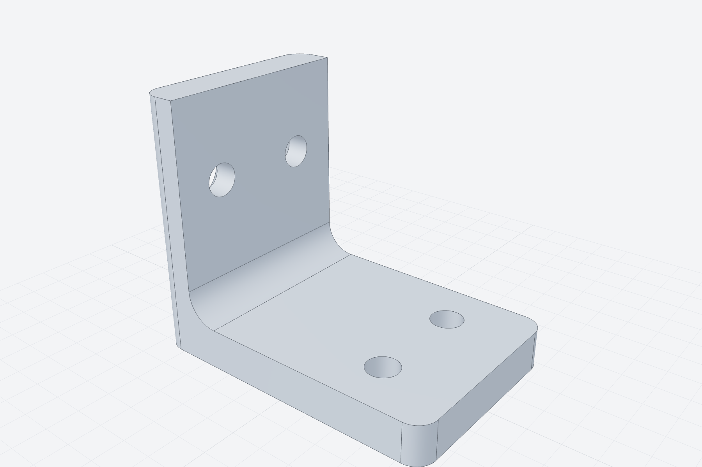
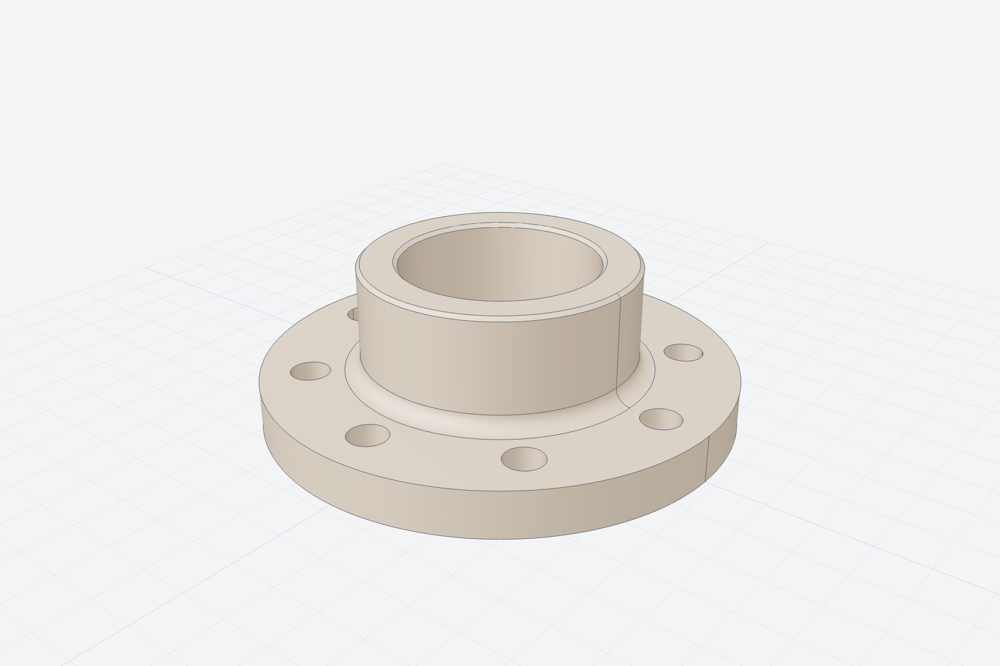
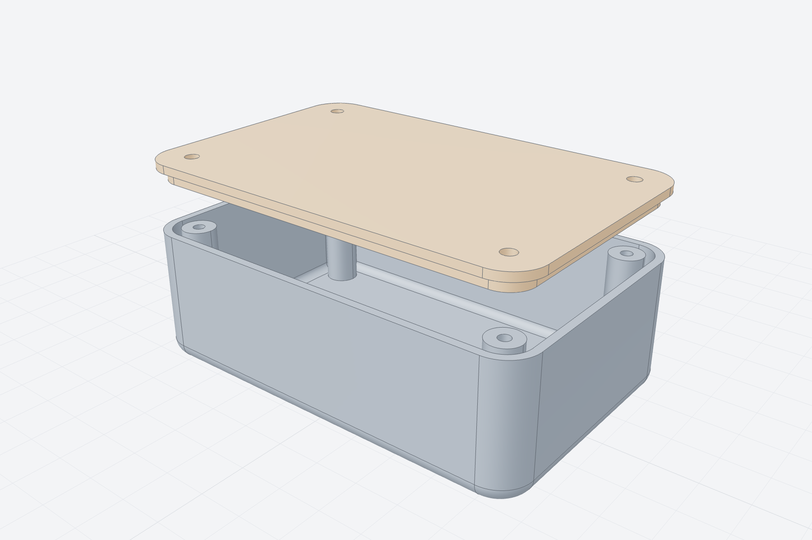
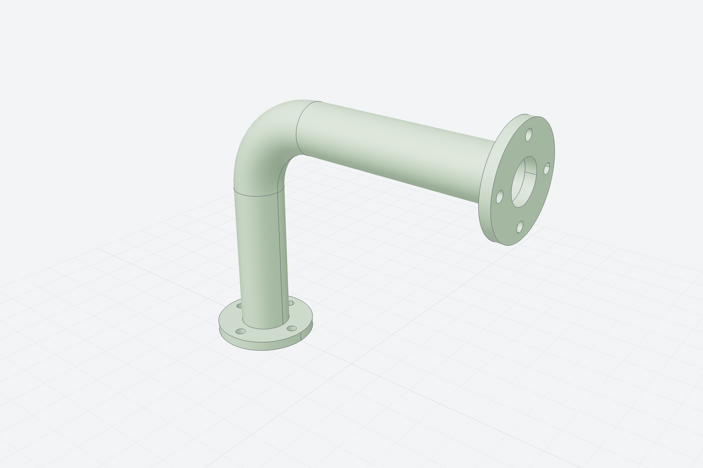
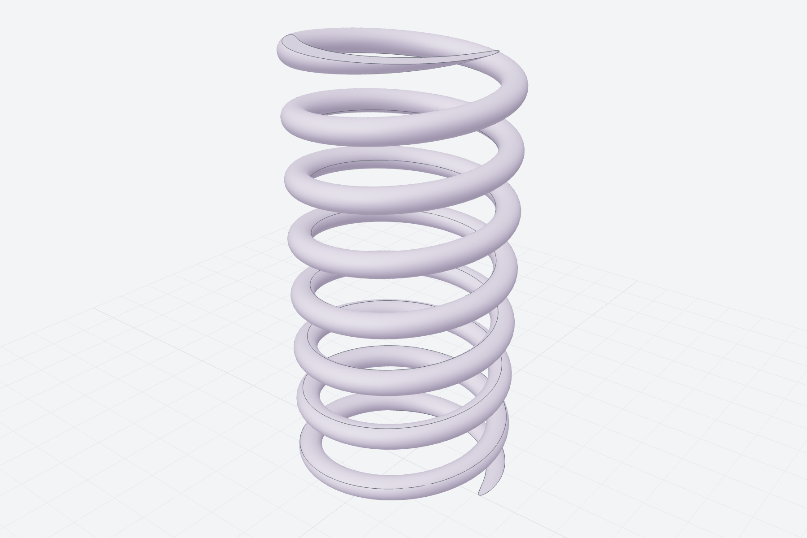
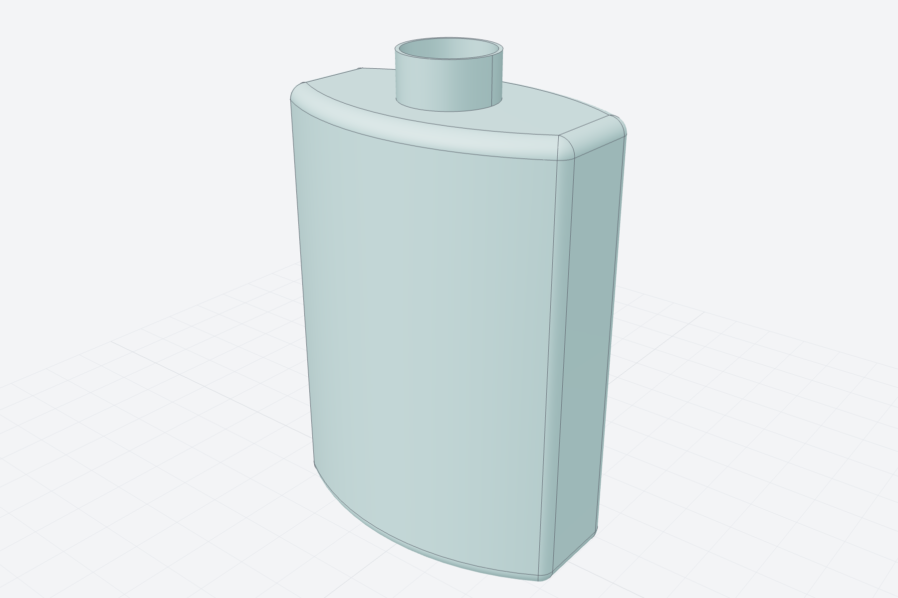
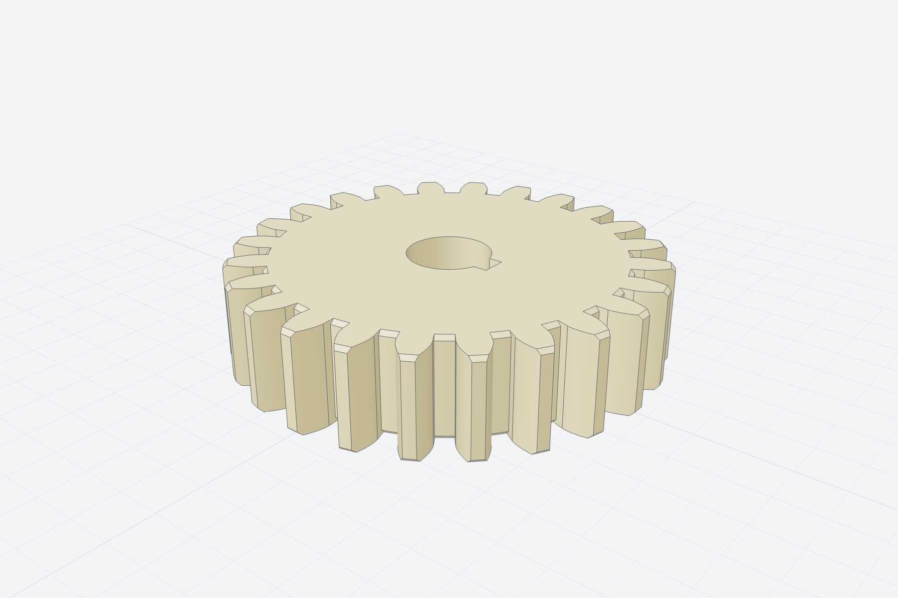
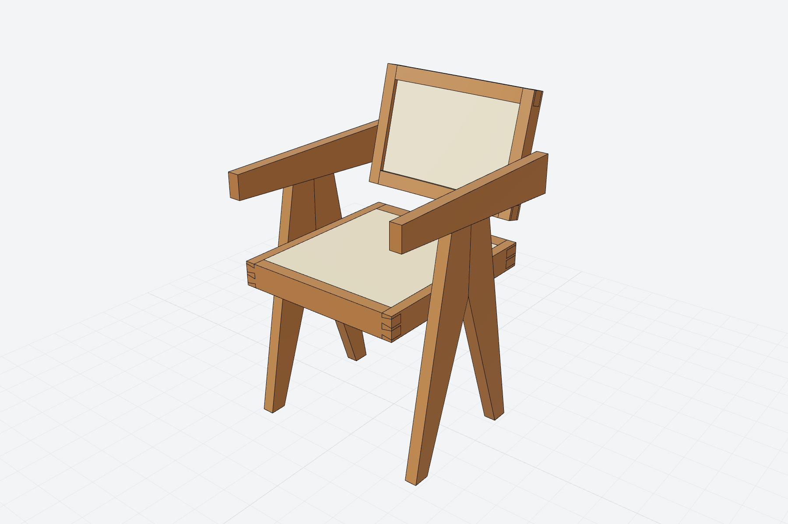

# Examples

Each example is a script in [`examples/`](https://github.com/awv-informatik/smlibpy/tree/main/examples) with a `model()` function. Run one to open the model in the viewer and write a STEP file:

```bash
python examples/flange.py
```

## Bracket

Mounting bracket: an L-profile extruded, with a rounded inner corner and holes in both flanges.



```py
from smlibpy import *


def model() -> Part:
    t = 8  # wall thickness
    profile = Polygon((0, 0), (60, 0), (60, t), (t, t), (t, 50), (0, 50))
    bracket = profile.on(Plane.front).extrude(-40)  # front plane faces -Y; extrude backwards

    bracket = bracket.fillet(bracket.edges().concave(), 6)
    vertical = bracket.edges().parallel_to(Z)
    bracket = bracket.fillet(vertical.min_by(X) + vertical.max_by(X), 4)  # round both ends

    base = bracket.faces().facing(Z).bottom()  # the base flange's top face at z = t
    upright = bracket.faces().facing(-X).one()
    bracket -= (GridLocations(24, 20, 1, 2) * Pos(8) * Hole(3.2, t)).on(base)
    bracket -= (GridLocations(20, 1, 2, 1) * Pos(0, 8) * CounterSinkHole(3.2, 6, t)).on(upright)
    return bracket.named("bracket").colored("#7c93b5")
```

## Flange

Pipe flange: a revolved cross-section with a bolt circle.



```py
from smlibpy import *


def model() -> Part:
    # half cross-section in the front plane (x = radius, y = height), revolved about Z
    section = Polygon((25, 0), (60, 0), (60, 12), (35, 12), (35, 40), (25, 40))
    flange = section.on(Plane.front).revolve(Z)

    flange -= PolarLocations(47.5, 8) * Cylinder(5, 30)
    flange = flange.fillet(flange.edges().concave(), 4)          # neck to plate
    flange = flange.chamfer(flange.faces().top().edges().circles(), 1)
    return flange.named("flange").colored("#b08e6c")
```

## Enclosure

Electronics enclosure: rounded box, shelled, with screw bosses and a matching lid.



```py
from smlibpy import *

C, MIN = Align.CENTER, Align.MIN


def model() -> ShapeList:
    w, d, h, wall = 100, 64, 32, 2
    box = RoundedRectangle(w, d, 8).extrude(h)
    box = box.fillet(box.faces().bottom().edges(), 4)
    box = box.shell(wall, box.faces().top())

    boss = Cylinder(4, h - wall, align=(C, C, MIN)) - Cylinder(1.4, h, align=(C, C, MIN))
    box += (GridLocations(w - 16, d - 16, 2, 2) * boss).translate(0, 0, wall)

    lid = RoundedRectangle(w, d, 8).extrude(wall)
    lip = RoundedRectangle(w - 2 * wall - 0.4, d - 2 * wall - 0.4, 6).extrude(-3)
    lid = (lid + lip) - GridLocations(w - 16, d - 16, 2, 2) * Cylinder(1.7, 20)
    lid = lid.translate(0, 0, h + 15)
    return ShapeList([box.named("box").colored("#5b6b7f"), lid.named("lid").colored("#d9925a")])
```

## Pipe

A bent pipe: a ring profile swept along a path of lines and arcs, with flanges at the ends.



```py
from smlibpy import *


def model() -> Part:
    r = 30  # bend radius
    path = Wire([
        Line((0, 0, 0), (0, 0, 60)),
        CenterArc((r, 60), r, 180, -90, plane=Plane.front),
        Line((r, 0, 60 + r), (r + 80, 0, 60 + r)),
    ])
    pipe = sweep(Circle(10) - Circle(8), path)

    flange = (Circle(20) - Circle(8) - PolarLocations(15, 4) * Circle(2)).extrude(4)
    start = flange.translate(0, 0, -4)
    end = flange.on(Plane((r + 80, 0, 60 + r), z_dir=(1, 0, 0)))
    return (pipe + start + end).named("pipe").colored("#79ad73")
```

## Spring

Compression spring: a circle swept along a helix, with ground ends.



```py
from smlibpy import *


def model() -> Part:
    coil = sweep(Circle(1.2), Helix(pitch=6, height=48, radius=10))
    coil = coil.split(Plane.XY.offset(1.2)).split(Plane.XY.offset(48 - 1.2), keep="below")
    return coil.named("spring").colored("#9d87c7")
```

## Bottle

The classic OpenCASCADE bottle, built with smlibpy.



```py
from smlibpy import *


def model() -> Part:
    width, thickness, height = 50.0, 30.0, 70.0

    # half of the base outline: a straight flank, an arc, another flank
    half = Wire([
        Line((-width / 2, 0), (-width / 2, -thickness / 4)),
        ThreePointArc((-width / 2, -thickness / 4), (0, -thickness / 2), (width / 2, -thickness / 4)),
        Line((width / 2, -thickness / 4), (width / 2, 0)),
    ])
    outline = half + half.mirror(Plane.XZ)

    body = make_face(outline).extrude(height)
    body = body.fillet(body.edges(), thickness / 12)

    neck = Cylinder(thickness / 4, height / 10, align=(Align.CENTER, Align.CENTER, Align.MIN)).translate(0, 0, height)
    bottle = body + neck
    bottle = bottle.shell(thickness / 50, bottle.faces().top())
    return bottle.named("bottle").colored("#6bb3b3")
```

## Gear

Involute spur gear with a bore and a keyway.



```py
import math

from smlibpy import *


def involute_tooth(module: float, teeth: int, pressure_angle: float = 20.0) -> Sketch:
    rp = module * teeth / 2                       # pitch radius
    rb = rp * math.cos(math.radians(pressure_angle))  # base radius
    ra = rp + module                               # tip radius
    rr = rp - 1.25 * module                        # root radius

    def involute(r: float) -> tuple[float, float]:
        t = math.sqrt(max((r / rb) ** 2 - 1, 0.0))
        return rb * (math.cos(t) + t * math.sin(t)), rb * (math.sin(t) - t * math.cos(t))

    # half tooth thickness at the pitch circle is a quarter of the circular pitch
    inv = lambda a: math.tan(a) - a  # noqa: E731
    half_angle = math.pi / (2 * teeth) + inv(math.radians(pressure_angle))
    start = max(rb, rr)
    pts = [involute(start + (ra - start) * i / 12) for i in range(13)]
    rot = lambda p, a: (p[0] * math.cos(a) - p[1] * math.sin(a), p[0] * math.sin(a) + p[1] * math.cos(a))  # noqa: E731
    right = [rot(p, -half_angle) for p in pts]
    left = [(x, -y) for x, y in reversed(right)]

    flank_r = Spline(*right)
    flank_l = Spline(*left)
    tip = ThreePointArc(right[-1], (ra, 0), left[0])
    root_r, root_l = (rr * 0.98, right[0][1] * rr / right[0][0]), (rr * 0.98, left[-1][1] * rr / left[-1][0])
    outline = Wire([Line(root_r, right[0]), flank_r, tip, flank_l, Line(left[-1], root_l), Line(root_l, root_r)])
    return make_face(outline)


def model(module: float = 2.0, teeth: int = 24, width: float = 12.0, bore: float = 10.0) -> Part:
    rr = module * teeth / 2 - 1.25 * module
    tooth = involute_tooth(module, teeth)
    profile = Circle(rr) + PolarLocations(0, teeth) * tooth
    profile = profile - Circle(bore / 2) - Rectangle(3, 3).translate(bore / 2, 0)
    gear = profile.extrude(width)
    gear = gear.chamfer(gear.edges().circles().filter(lambda e: e.radius > bore), 0.5)
    return gear.named("gear").colored("#d4b45a")
```

## Compass_armchair

Cane armchair on compass legs, after the 1955 Chandigarh office chair, measured from a side view: the curved back
stands between the armrests, each 30 x 40 post held to its armrest by one loose tenon; through dovetails at the four
corners of the seat frame and of the back frame.



```py
import math

from smlibpy import *

# Taken off a side photograph at 2.78 mm a pixel (the floor and the 81 cm of the catalogue as the scale), and the
# catalogue: 51 cm over the arms, 55 deep, seat 43-45, arms 66. The chair faces -Y; x = 0 is its middle. The legs
# and the armrest of a side are boards of one thickness, all in one plane; the back stands between the armrests.
W, LEG_T = 480.0, 30.0  # outside width over the boards; their thickness across the chair
FRONT_FOOT, REAR_FOOT = (-181.0, -139.0), (139.0, 181.0)  # the feet on the floor, front edge to back edge
NOTCH_Z = 400.0  # where the two boards of a side part, on the seam y = 0; above it they are one up to the armrest
ARM_EDGES = (-70.0, 70.0)  # the two boards' outer edges where they meet the armrest: the V is isosceles
SPLINE, SPLINE_Z = (20.0, 16.0), 457.0  # a loose tenon on the seam, across and thick, from this height up
SPLINE_IN_ARM = 40.0  # how far it goes on into the armrest
ARM_TOP, ARM_FRONT = 645.0, -235.0  # the armrest, a blade on edge: its level top and its nose
ARM_HEIGHT = ((-235.0, 60.0), (280.0, 95.0))  # (y, height) at the nose and at the back: the underside slopes
SEAT_TOP, RAIL_H, RAIL_T, CANE = 437.0, 60.0, 25.0, 8.0  # the seat frame: top, rail height and thickness; cane
SEAT_Y, FRONT_RAIL_T, REAR_RAIL_T = (-229.0, 240.0), 30.0, 40.0  # the side rails, nose to back; the cross rails
TENON, LEG_TENON_Y = (20.0, 10.0, 40.0), (-55.0, 55.0)  # the side rails' stub tenons: depth, thickness, height; y
BACK_TILT, POST = 15.0, (30.0, 40.0)  # the back leans 15 degrees; a post: across, deep
POST_Y_AT_ARM = 260.0  # the posts' axis at the armrest's top
BOW = 10.0  # the back's arc bows this much between the posts; its rails are that much less deep than the posts
RAIL_D = POST[1] - BOW  # so that the bow hides within the posts' depth
BACK_RAILS = ((65.0, 100.0), (330.0, 365.0))  # along the posts, from seat height; the posts end flush with them
# The armrest runs on behind the back, its end square to its top: by this much behind the posts' rear face, at the
# armrest's mid-height.
ARM_BEHIND = 40.0
# One loose tenon (along x) joins each post to its armrest, half in each: thick, deep into each part, and the wood
# left above and below its mortise in the armrest.
ARM_TENON, ARM_TENON_DEPTH, ARM_TENON_MARGIN = 12.0, 15.0, 8.0
SLOPE = 1 / 6  # of the dovetails: 1 in 6, as for hardwood
SEAT_TAILS, SEAT_PIN_EDGE, SEAT_PIN_MID = 2, 6.0, 6.0  # tails per seat corner; the pins at the side rail's outside
BACK_TAIL_SHOULDER = 2.0  # the back rail's shoulder behind its tail, at the post's inner face
BIG = 3000.0

X_BOARD = W / 2 - LEG_T  # the inner face of a side's boards: the posts' outer face lies on it
X_POST = X_BOARD - POST[0]  # the posts' inner face, where the back's rails and cane meet them
X_RAIL = X_BOARD - RAIL_T  # the side rails' inner faces
LEAN = math.radians(BACK_TILT)
POST_Y = POST_Y_AT_ARM - (ARM_TOP - SEAT_TOP) * math.tan(LEAN)  # the posts' axis at seat height
R_BACK = (X_POST**2 + BOW**2) / (2 * BOW) + RAIL_D / 2  # the radius of the arc's middle line
# The arc's center: the rails' rear face is flush with the posts' rear face at the middle, their front face with
# the posts' front face at the ends, so that nothing of the back shows beyond the posts in a side view.
ARC_Y = POST[1] / 2 - (R_BACK + RAIL_D / 2)
# The seat's tails, on the cross rails: at the side rail's outer face (end) and at its inner face (base).
SEAT_TAIL_END = (RAIL_H - 2 * SEAT_PIN_EDGE - (SEAT_TAILS - 1) * SEAT_PIN_MID) / SEAT_TAILS
SEAT_TAIL_BASE = SEAT_TAIL_END - 2 * RAIL_T * SLOPE
# The back's tail, on the rail's end, centered on the post's axis: at the post's inner face and at its outer face.
BACK_TAIL_BASE = 2 * (POST[1] / 2 - BOW - BACK_TAIL_SHOULDER)
BACK_TAIL_END = BACK_TAIL_BASE + 2 * POST[0] * SLOPE


def underside(y: float) -> float:
    """The armrest's lower face: a straight slope from the nose to the back."""
    (y0, h0), (y1, h1) = ARM_HEIGHT
    return ARM_TOP - h0 - (h1 - h0) * (y - y0) / (y1 - y0)


def post_face(z: float, side: float) -> float:
    """y of a post's front (side -1) or rear (+1) face at height z, in the side view."""
    return POST_Y + (z - SEAT_TOP) * math.tan(LEAN) + side * POST[1] / 2 / math.cos(LEAN)


def meet_underside(side: float) -> tuple[float, float]:
    """Where a post's face (front -1, rear +1) crosses the armrest's underside, in the side view."""
    (y0, h0), (y1, h1) = ARM_HEIGHT
    # the underside: z = ARM_TOP - h0 - slope (y - y0); the face: y = a + b z
    slope, a = (h1 - h0) / (y1 - y0), post_face(0, side)
    b = math.tan(LEAN)
    y = (a + b * (ARM_TOP - h0 + slope * y0)) / (1 + b * slope)
    return y, underside(y)


ARM_END = post_face((ARM_TOP + meet_underside(1)[1]) / 2, 1) + ARM_BEHIND  # the armrest's square rear end


def arm_tenon_span() -> tuple[float, float]:
    """The loose tenon's extent along the post (back frame z): within the armrest, ARM_TENON_MARGIN from its top and
    its underside at every corner of the tenon's section."""
    c, s = math.cos(LEAN), math.sin(LEAN)
    k = (ARM_HEIGHT[1][1] - ARM_HEIGHT[0][1]) / (ARM_HEIGHT[1][0] - ARM_HEIGHT[0][0])  # underside(y) = u0 - k y
    t = ARM_TENON / 2
    # world z of (y', z') is SEAT_TOP - y' s + z' c, world y is POST_Y + y' c + z' s; the front corner is highest
    top = (ARM_TOP - ARM_TENON_MARGIN - SEAT_TOP - t * s) / c
    # above the underside: the rear corner is the one nearest to it
    bottom = (underside(0) - k * POST_Y + ARM_TENON_MARGIN - SEAT_TOP + t * (s - k * c)) / (c + k * s)
    return bottom, top


FRONT_LEG = [
    (FRONT_FOOT[0], 0),
    (FRONT_FOOT[1], 0),
    (0, NOTCH_Z),
    (0, underside(0)),
    (ARM_EDGES[0], underside(ARM_EDGES[0])),
]
# Its mirror image about the seam, but for the top: both boards' tops follow the armrest's sloping underside.
REAR_LEG = [
    (REAR_FOOT[0], 0),
    (REAR_FOOT[1], 0),
    (ARM_EDGES[1], underside(ARM_EDGES[1])),
    (0, underside(0)),
    (0, NOTCH_Z),
]
ARM_PROFILE = [
    (ARM_FRONT, underside(ARM_FRONT)),
    (ARM_FRONT, ARM_TOP),
    (ARM_END, ARM_TOP),
    (ARM_END, underside(ARM_END)),
]


def side_prism(profile: list[tuple[float, float]], x_min: float, thickness: float) -> Part:
    """A board seen from the side: its profile in (y, z), extruded across the chair from x_min."""
    board = Polygon(*profile).on(Plane.YZ).extrude(thickness)
    return board.translate(x_min - board.bbox().min.x, 0, 0)


def tilt(shape):
    """From the back's own frame (upright, its origin at seat height) to the chair: leaned back 15 degrees."""
    return Pos(0, POST_Y, SEAT_TOP) * (Rot(x=-BACK_TILT) * shape)


def arc_band(r_in: float, r_out: float) -> Sketch:
    """The back's curve between two radii, from post to post: concave toward the sitter."""
    band = (Circle(r_out) - Circle(r_in)).translate(0, ARC_Y, 0)
    return band & Rectangle(2 * X_POST, BIG, align=(Align.CENTER, Align.MIN)).translate(0, ARC_Y, 0)


def trapezoid(x_end: float, x_base: float, middle: float, end: float, base: float) -> list[tuple[float, float]]:
    """A tail in its plane: its end at x_end, its base at x_base, both centered on `middle`."""
    return [
        (x_end, middle - end / 2),
        (x_base, middle - base / 2),
        (x_base, middle + base / 2),
        (x_end, middle + end / 2),
    ]


def seat_tails(y0: float, y1: float) -> Part:
    """The tails at the +x end of a cross rail between y0 and y1: trapezoids on its face (x, z), through its
    thickness, wide at the side rail's outer face; the side rail's pins are what they leave of it."""
    sketch = None
    for i in range(SEAT_TAILS):
        z = SEAT_TOP - RAIL_H + SEAT_PIN_EDGE + SEAT_TAIL_END / 2 + i * (SEAT_TAIL_END + SEAT_PIN_MID)
        tail = Polygon(*trapezoid(X_BOARD, X_RAIL, z, SEAT_TAIL_END, SEAT_TAIL_BASE))
        sketch = tail if sketch is None else sketch + tail
    tails = sketch.on(Plane.XZ).extrude(y1 - y0)
    return tails.translate(0, y0 - tails.bbox().min.y, 0)


def back_tail(z0: float, z1: float) -> Part:
    """In the back's frame: the tail at the +x end of a back rail, a trapezoid in plan (x, y) through the rail's
    height, from the post's inner face to its outer face; it slides in along the post, and locks the rail against
    pulling out of it."""
    tail = Polygon(*[(x, y) for x, y in trapezoid(X_BOARD, X_POST, 0, BACK_TAIL_END, BACK_TAIL_BASE)])
    return tail.extrude(z1 - z0).translate(0, 0, z0)


def arm_tenon() -> Part:
    """In the back's frame: the loose tenon of the +x post, along x across the post's outer face."""
    z0, z1 = arm_tenon_span()
    tenon = Box(2 * ARM_TENON_DEPTH, ARM_TENON, z1 - z0, align=(Align.CENTER, Align.CENTER, Align.MIN))
    return tenon.translate(X_BOARD, 0, z0)


def back_post() -> Part:
    """In the back's frame: the +x post, its ends cut into sockets by the rails' tails, the tenon's mortise."""
    post = Box(*POST, BACK_RAILS[1][1] - BACK_RAILS[0][0], align=(Align.MIN, Align.CENTER, Align.MIN))
    post = post.translate(X_POST, 0, BACK_RAILS[0][0])
    return post - [back_tail(z0, z1) for z0, z1 in BACK_RAILS] - arm_tenon()


def model() -> list[Part]:
    teak, cane = "#9b6a3c", "#e6d2a0"
    x_mid = X_BOARD + LEG_T / 2  # the middle of a board's thickness, where the spline sits
    z_tenon = SEAT_TOP - RAIL_H / 2
    front_tails = seat_tails(SEAT_Y[0], SEAT_Y[0] + FRONT_RAIL_T)
    rear_tails = seat_tails(SEAT_Y[1] - REAR_RAIL_T, SEAT_Y[1])
    parts = []
    for side in (1, -1):
        front, rear = side_prism(FRONT_LEG, X_BOARD, LEG_T), side_prism(REAR_LEG, X_BOARD, LEG_T)
        spline = Box(*SPLINE, underside(0) + SPLINE_IN_ARM - SPLINE_Z, align=(Align.CENTER, Align.CENTER, Align.MIN))
        spline = spline.translate(x_mid, 0, SPLINE_Z)  # through the seam and on into the armrest
        tenons = [
            Box(*TENON, align=(Align.MIN, Align.CENTER, Align.CENTER)).translate(X_BOARD, y, z_tenon)
            for y in LEG_TENON_Y
        ]
        front -= [spline, tenons[0]]  # its half of the spline's slot, and the side rail's tenon
        rear -= [spline, tenons[1]]
        rail = Box(RAIL_T, SEAT_Y[1] - SEAT_Y[0], RAIL_H, align=(Align.MAX, Align.MIN, Align.MAX)).translate(
            X_BOARD, SEAT_Y[0], SEAT_TOP
        )
        rail = rail + tenons - [front_tails, rear_tails]  # its pins: what the cross rails' tails leave of its ends
        loose = tilt(arm_tenon())
        arm = side_prism(ARM_PROFILE, X_BOARD, LEG_T) - [spline, loose]  # the spline's and the tenon's mortises
        named = [
            (front, "front leg"),
            (rear, "rear leg"),
            (spline, "spline"),
            (rail, "side rail"),
            (arm, "armrest"),
            (tilt(back_post()), "back post"),
            (loose, "arm tenon"),
        ]
        for p, name in named:
            parts.append((p.mirror(Plane.YZ) if side < 0 else p).named(name).colored(teak))

    def cross_rail(y0: float, t: float, tails: Part) -> Part:
        """A cross rail to the side rails' outer faces, its ends cut into tails."""
        rail = Box(2 * X_BOARD, t, RAIL_H, align=(Align.CENTER, Align.MIN, Align.MAX)).translate(0, y0, SEAT_TOP)
        end = Box(RAIL_T, t, RAIL_H, align=(Align.MIN, Align.MIN, Align.MAX)).translate(X_RAIL, y0, SEAT_TOP) - tails
        return rail - [end, end.mirror(Plane.YZ)]

    parts.append(cross_rail(SEAT_Y[0], FRONT_RAIL_T, front_tails).named("front rail").colored(teak))
    parts.append(cross_rail(SEAT_Y[1] - REAR_RAIL_T, REAR_RAIL_T, rear_tails).named("rear rail").colored(teak))
    # The cane is a flat panel that touches its rails: the weave is not modelled.
    seat = Box(
        2 * X_RAIL, SEAT_Y[1] - REAR_RAIL_T - SEAT_Y[0] - FRONT_RAIL_T, CANE, align=(Align.CENTER, Align.MIN, Align.MAX)
    )
    parts.append(seat.translate(0, SEAT_Y[0] + FRONT_RAIL_T, SEAT_TOP).named("seat cane").colored(cane))
    for member, name in back_frame():
        parts.append(tilt(member).named(name).colored(cane if name == "back cane" else teak))
    return parts


def back_frame() -> list[tuple[Part, str]]:
    """The back's rails and cane panel, in the back's own frame: arcs between the posts' inner faces that stay
    within the posts' depth, the rails' ends cut into tails through the posts."""
    members = []
    for z0, z1 in BACK_RAILS:
        rail = arc_band(R_BACK - RAIL_D / 2, R_BACK + RAIL_D / 2).extrude(z1 - z0).translate(0, 0, z0)
        tail = back_tail(z0, z1)
        members.append((rail + [tail, tail.mirror(Plane.YZ)], "back rail"))
    panel = arc_band(R_BACK - CANE / 2, R_BACK + CANE / 2).extrude(BACK_RAILS[1][0] - BACK_RAILS[0][1])
    members.append((panel.translate(0, 0, BACK_RAILS[0][1]), "back cane"))
    return members


def area(polygon: list[tuple[float, float]]) -> float:
    """The shoelace formula."""
    return abs(sum(x0 * y1 - x1 * y0 for (x0, y0), (x1, y1) in zip(polygon, polygon[1:] + polygon[:1]))) / 2


def arc_band_area(r_in: float, r_out: float, half_width: float) -> float:
    """Between two concentric arcs, cut square at x = +-half_width: the integral of sqrt(r^2 - x^2), closed form."""

    def under(r: float) -> float:
        return half_width * math.sqrt(r**2 - half_width**2) + r**2 * math.asin(half_width / r)

    return under(r_out) - under(r_in)


BACK = ("back post", "back rail", "back cane")


def assembly_order(by_name: dict[str, list[Part]]) -> None:
    """The chair goes together in this order, each member sliding straight in, which is tested by moving it along
    its way in and finding no overlap at any depth (a dovetail or a tenon is a prism along that way):
    1. the seat frame: the front rail's tails slide into the side rails along +y, the rear rail's along -y;
    2. the back frame: the cane between the rails, the upper rail's tails slide down into the posts' tops along the
       posts, the lower rail's up into their bottoms; a loose tenon is glued into each post's outer face;
    3. each side (legs, spline, armrest, glued up) is pushed on along x, over the side rails' stub tenons and the
       loose tenon at once, the post's outer face coming to rest on the armrest's inner face."""

    def free(moving: list[Part], fixed: list[Part], direction: tuple[float, float, float], depths) -> None:
        for d in depths:
            for m in moving:
                moved = m.translate(*(d * c for c in direction))
                for f in fixed:
                    if moved.distance_to(f) < 1e-9:  # only touching or overlapping pairs can collide
                        overlap = (moved & f).volume
                        assert overlap < 1e-6, (m.name, f.name, direction, d, overlap)

    side_rails = by_name["side rail"]
    free(by_name["front rail"], side_rails, (0, -1, 0), (0.5, 10, FRONT_RAIL_T + 1))
    free(by_name["rear rail"], side_rails, (0, 1, 0), (0.5, 10, REAR_RAIL_T + 1))
    axis = (0.0, math.sin(LEAN), math.cos(LEAN))  # along the posts, upward
    lower, upper = sorted(by_name["back rail"], key=lambda p: p.bbox().center.z)
    depths = (0.5, 10, BACK_RAILS[0][1] - BACK_RAILS[0][0] + 1)
    free([upper], by_name["back post"], axis, depths)
    free([lower], by_name["back post"], tuple(-c for c in axis), depths)
    middle = side_rails + by_name["back post"] + by_name["arm tenon"]
    for s in (1, -1):
        side = [
            p for n in ("front leg", "rear leg", "spline", "armrest") for p in by_name[n] if p.bbox().center.x * s > 0
        ]
        free(side, middle, (s, 0, 0), (0.5, 10, max(TENON[0], ARM_TENON_DEPTH) + 1))


def check(parts: list[Part]) -> None:
    """Worked out by hand: side-view polygons by the shoelace formula, arcs by their integral, prisms by Cavalieri;
    a dovetail is its trapezoid's area times its length, the pins are the board less the tails."""
    tenon = math.prod(TENON)
    spline = SPLINE[0] * SPLINE[1] * (underside(0) + SPLINE_IN_ARM - SPLINE_Z)  # a box
    arm_mortise = SPLINE[0] * SPLINE[1] * SPLINE_IN_ARM  # the spline's top, in the armrest above its slope
    # each board's half of the spline's slot, cut on the slope at its own centroid
    half_slot = [SPLINE[0] * SPLINE[1] / 2 * (underside(y) - SPLINE_Z) for y in (-SPLINE[1] / 4, SPLINE[1] / 4)]
    z0, z1 = arm_tenon_span()
    loose = ARM_TENON * (z1 - z0) * 2 * ARM_TENON_DEPTH  # a box, half in each part
    seat_tail = (SEAT_TAIL_END + SEAT_TAIL_BASE) / 2 * RAIL_T  # a tail's face; times the cross rail's thickness
    back_tail = (BACK_TAIL_END + BACK_TAIL_BASE) / 2 * POST[0]  # in plan; times the rail's height
    rail_h, panel_h = BACK_RAILS[0][1] - BACK_RAILS[0][0], BACK_RAILS[1][0] - BACK_RAILS[0][1]
    tails = {t: SEAT_TAILS * seat_tail * t for t in (FRONT_RAIL_T, REAR_RAIL_T)}  # one end of a cross rail
    plain = {  # every member without its joinery
        "front leg": area(FRONT_LEG) * LEG_T,
        "rear leg": area(REAR_LEG) * LEG_T,
        "spline": spline,
        "side rail": RAIL_T * (SEAT_Y[1] - SEAT_Y[0]) * RAIL_H,
        "armrest": area(ARM_PROFILE) * LEG_T,
        "back post": POST[0] * POST[1] * (BACK_RAILS[1][1] - BACK_RAILS[0][0]),
        "arm tenon": loose,
        "front rail": 2 * X_BOARD * FRONT_RAIL_T * RAIL_H,
        "rear rail": 2 * X_BOARD * REAR_RAIL_T * RAIL_H,
        "seat cane": 2 * X_RAIL * (SEAT_Y[1] - REAR_RAIL_T - SEAT_Y[0] - FRONT_RAIL_T) * CANE,
        "back rail": arc_band_area(R_BACK - RAIL_D / 2, R_BACK + RAIL_D / 2, X_POST) * rail_h,
        "back cane": arc_band_area(R_BACK - CANE / 2, R_BACK + CANE / 2, X_POST) * panel_h,
    }
    joinery = {
        "front leg": -half_slot[0] - tenon,
        "rear leg": -half_slot[1] - tenon,
        "side rail": 2 * tenon - sum(tails.values()),
        "armrest": -arm_mortise - loose / 2,
        "back post": -2 * back_tail * rail_h - loose / 2,
        "front rail": -2 * (RAIL_T * FRONT_RAIL_T * RAIL_H - tails[FRONT_RAIL_T]),  # the sockets at both ends
        "rear rail": -2 * (RAIL_T * REAR_RAIL_T * RAIL_H - tails[REAR_RAIL_T]),
        "back rail": 2 * back_tail * rail_h,
    }
    wants = []
    for part in parts:
        want = plain[part.name] + joinery.get(part.name, 0)
        assert part.is_valid() and abs(part.volume - want) < 1e-6 * want, (part.name, part.volume, want)
        wants.append(want)
    # Fused one at a time, in an order the kernel's Boolean takes: each post with its loose tenons, then its
    # armrest, then the rest of its side. (Post and armrest first, then the tenon, gives a wrong volume.)
    order = ("back post", "arm tenon", "armrest", "spline", "front leg", "rear leg", "side rail")
    sides = [[p for p in parts if p.name in order and (p.bbox().center.x > 0) == right] for right in (True, False)]
    whole = None
    for part in [p for side in sides for p in sorted(side, key=lambda p: order.index(p.name))] + [
        p for p in parts if p.name not in order
    ]:
        whole = part if whole is None else whole + part
    # Every tenon and tail fills its mortise or socket exactly: the whole is the sum of its parts, nothing overlaps.
    assert abs(whole.volume - sum(wants)) < 1e-6 * sum(wants), (whole.volume, sum(wants))
    assert len(whole.solids()) == 1  # one piece: the back hangs on the armrests
    by_name: dict[str, list[Part]] = {}
    for part in parts:
        by_name.setdefault(part.name, []).append(part)
    for a, b in (
        ("armrest", "front leg"),
        ("armrest", "rear leg"),
        ("armrest", "spline"),
        ("armrest", "back post"),  # the post's outer face on the armrest's inner face
        ("armrest", "arm tenon"),
        ("back post", "arm tenon"),
        ("back post", "back rail"),
        ("back cane", "back rail"),
        ("side rail", "front leg"),
        ("side rail", "front rail"),
        ("side rail", "rear rail"),
        ("seat cane", "front rail"),
        ("rear leg", "front leg"),
    ):
        assert by_name[a][0].distance_to(by_name[b][0]) < 1e-6, (a, b)  # they touch
    post, arm = by_name["back post"][0], by_name["armrest"][0]
    contact = (post.bbox().max.x, arm.bbox().min.x)
    assert abs(contact[0] - X_BOARD) < 1e-6 and abs(contact[1] - X_BOARD) < 1e-6, contact  # no lap: face to face
    behind = arm.bbox().max.y - post_face((ARM_TOP + meet_underside(1)[1]) / 2, 1)  # at the armrest's mid-height
    assert abs(behind - ARM_BEHIND) < 1e-6, behind  # the armrest runs on behind the back
    for name in BACK:  # the back is held by the armrests alone: it touches nothing else but its tenons
        for other in by_name:
            if other not in BACK and other not in ("armrest", "arm tenon"):
                assert by_name[name][0].distance_to(by_name[other][0]) > 0.5, (name, other)
    for name in ("front leg", "rear leg"):
        assert all(abs(p.bbox().min.z) < 1e-6 for p in by_name[name]), name  # feet flat on the floor
    for member, name in back_frame():  # in the back's own frame: nothing of it before or behind the posts
        box = member.bbox()
        assert box.min.y > -POST[1] / 2 - 1e-6 and box.max.y < POST[1] / 2 + 1e-6, (name, box.min.y, box.max.y)
    # The loose tenon stays clear of the lower rail's dovetail, which runs through the post's whole width.
    clearance = z0 - BACK_RAILS[0][1]
    assert clearance > 5, clearance
    # The side rails' stub tenons stay clear of the dovetailed corners.
    assert (
        LEG_TENON_Y[0] - TENON[1] / 2 > SEAT_Y[0] + FRONT_RAIL_T
        and LEG_TENON_Y[1] + TENON[1] / 2 < SEAT_Y[1] - REAR_RAIL_T
    )
    assembly_order(by_name)
    teak = sum(p.mass_properties(density=0.65e-3).mass for p in parts if "cane" not in p.name)
    print(f"{len(parts)} parts, {whole.bbox().size} mm over all, teak {teak / 1000:.2f} kg")
    print(f"loose tenons {z1 - z0:.1f} high, {clearance:.1f} mm clear of the lower back rail's tail")
```
