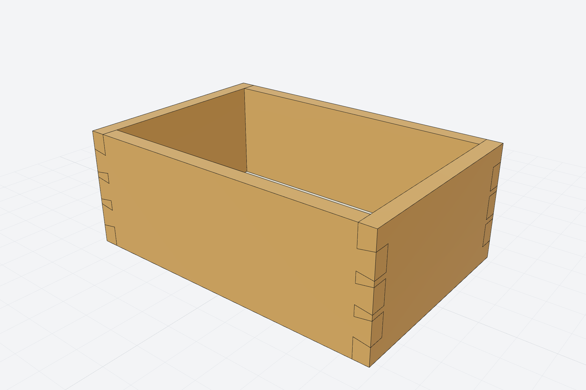

# Examples

Each example is a script in [`examples/`](https://github.com/awv-informatik/smlibpy/tree/main/examples) with a `model()` function. Run one to open the model in the viewer and write a STEP file:

```bash
python examples/flange.py
```

## Bracket

Mounting bracket: an L-profile extruded, with a rounded inner corner and holes in both flanges.


```py
from smlibpy import *


def model() -> Part:
    t = 8  # wall thickness
    profile = Polygon((0, 0), (60, 0), (60, t), (t, t), (t, 50), (0, 50))
    bracket = profile.on(Plane.front).extrude(-40)  # front plane faces -Y; extrude backwards

    bracket = bracket.fillet(bracket.edges().concave(), 6)
    vertical = bracket.edges().parallel_to(Z)
    bracket = bracket.fillet(vertical.min_by(X) + vertical.max_by(X), 4)  # round both ends

    base = bracket.faces().facing(Z).bottom()  # the base flange's top face at z = t
    upright = bracket.faces().facing(-X).one()
    bracket -= (GridLocations(24, 20, 1, 2) * Pos(8) * Hole(3.2, t)).on(base)
    bracket -= (GridLocations(20, 1, 2, 1) * Pos(0, 8) * CounterSinkHole(3.2, 6, t)).on(upright)
    return bracket.named("bracket").colored("#7c93b5")
```

## Flange

Pipe flange: a revolved cross-section with a bolt circle.


```py
from smlibpy import *


def model() -> Part:
    # half cross-section in the front plane (x = radius, y = height), revolved about Z
    section = Polygon((25, 0), (60, 0), (60, 12), (35, 12), (35, 40), (25, 40))
    flange = section.on(Plane.front).revolve(Z)

    flange -= PolarLocations(47.5, 8) * Cylinder(5, 30)
    flange = flange.fillet(flange.edges().concave(), 4)          # neck to plate
    flange = flange.chamfer(flange.faces().top().edges().circles(), 1)
    return flange.named("flange").colored("#b08e6c")
```

## Enclosure

Electronics enclosure: rounded box, shelled, with screw bosses and a matching lid.


```py
from smlibpy import *

C, MIN = Align.CENTER, Align.MIN


def model() -> ShapeList:
    w, d, h, wall = 100, 64, 32, 2
    box = RoundedRectangle(w, d, 8).extrude(h)
    box = box.fillet(box.faces().bottom().edges(), 4)
    box = box.shell(wall, box.faces().top())

    boss = Cylinder(4, h - wall, align=(C, C, MIN)) - Cylinder(1.4, h, align=(C, C, MIN))
    box += (GridLocations(w - 16, d - 16, 2, 2) * boss).translate(0, 0, wall)

    lid = RoundedRectangle(w, d, 8).extrude(wall)
    lip = RoundedRectangle(w - 2 * wall - 0.4, d - 2 * wall - 0.4, 6).extrude(-3)
    lid = (lid + lip) - GridLocations(w - 16, d - 16, 2, 2) * Cylinder(1.7, 20)
    lid = lid.translate(0, 0, h + 15)
    return ShapeList([box.named("box").colored("#5b6b7f"), lid.named("lid").colored("#d9925a")])
```

## Pipe

A bent pipe: a ring profile swept along a path of lines and arcs, with flanges at the ends.


```py
from smlibpy import *


def model() -> Part:
    r = 30  # bend radius
    path = Wire([
        Line((0, 0, 0), (0, 0, 60)),
        CenterArc((r, 60), r, 180, -90, plane=Plane.front),
        Line((r, 0, 60 + r), (r + 80, 0, 60 + r)),
    ])
    pipe = sweep(Circle(10) - Circle(8), path)

    flange = (Circle(20) - Circle(8) - PolarLocations(15, 4) * Circle(2)).extrude(4)
    start = flange.translate(0, 0, -4)
    end = flange.on(Plane((r + 80, 0, 60 + r), z_dir=(1, 0, 0)))
    return (pipe + start + end).named("pipe").colored("#79ad73")
```

## Spring

Compression spring: a circle swept along a helix, with ground ends.


```py
from smlibpy import *


def model() -> Part:
    coil = sweep(Circle(1.2), Helix(pitch=6, height=48, radius=10))
    coil = coil.split(Plane.XY.offset(1.2)).split(Plane.XY.offset(48 - 1.2), keep="below")
    return coil.named("spring").colored("#9d87c7")
```

## Bottle

The classic OpenCASCADE bottle, built with smlibpy.


```py
from smlibpy import *


def model() -> Part:
    width, thickness, height = 50.0, 30.0, 70.0

    # half of the base outline: a straight flank, an arc, another flank
    half = Wire([
        Line((-width / 2, 0), (-width / 2, -thickness / 4)),
        ThreePointArc((-width / 2, -thickness / 4), (0, -thickness / 2), (width / 2, -thickness / 4)),
        Line((width / 2, -thickness / 4), (width / 2, 0)),
    ])
    outline = half + half.mirror(Plane.XZ)

    body = make_face(outline).extrude(height)
    body = body.fillet(body.edges(), thickness / 12)

    neck = Cylinder(thickness / 4, height / 10, align=(Align.CENTER, Align.CENTER, Align.MIN)).translate(0, 0, height)
    bottle = body + neck
    bottle = bottle.shell(thickness / 50, bottle.faces().top())
    return bottle.named("bottle").colored("#6bb3b3")
```

## Gear

Involute spur gear with a bore and a keyway.


```py
import math

from smlibpy import *


def involute_tooth(module: float, teeth: int, pressure_angle: float = 20.0) -> Sketch:
    rp = module * teeth / 2                       # pitch radius
    rb = rp * math.cos(math.radians(pressure_angle))  # base radius
    ra = rp + module                               # tip radius
    rr = rp - 1.25 * module                        # root radius

    def involute(r: float) -> tuple[float, float]:
        t = math.sqrt(max((r / rb) ** 2 - 1, 0.0))
        return rb * (math.cos(t) + t * math.sin(t)), rb * (math.sin(t) - t * math.cos(t))

    # half tooth thickness at the pitch circle is a quarter of the circular pitch
    inv = lambda a: math.tan(a) - a  # noqa: E731
    half_angle = math.pi / (2 * teeth) + inv(math.radians(pressure_angle))
    start = max(rb, rr)
    pts = [involute(start + (ra - start) * i / 12) for i in range(13)]
    rot = lambda p, a: (p[0] * math.cos(a) - p[1] * math.sin(a), p[0] * math.sin(a) + p[1] * math.cos(a))  # noqa: E731
    right = [rot(p, -half_angle) for p in pts]
    left = [(x, -y) for x, y in reversed(right)]

    flank_r = Spline(*right)
    flank_l = Spline(*left)
    tip = ThreePointArc(right[-1], (ra, 0), left[0])
    root_r, root_l = (rr * 0.98, right[0][1] * rr / right[0][0]), (rr * 0.98, left[-1][1] * rr / left[-1][0])
    outline = Wire([Line(root_r, right[0]), flank_r, tip, flank_l, Line(left[-1], root_l), Line(root_l, root_r)])
    return make_face(outline)


def model(module: float = 2.0, teeth: int = 24, width: float = 12.0, bore: float = 10.0) -> Part:
    rr = module * teeth / 2 - 1.25 * module
    tooth = involute_tooth(module, teeth)
    profile = Circle(rr) + PolarLocations(0, teeth) * tooth
    profile = profile - Circle(bore / 2) - Rectangle(3, 3).translate(bore / 2, 0)
    gear = profile.extrude(width)
    gear = gear.chamfer(gear.edges().circles().filter(lambda e: e.radius > bore), 0.5)
    return gear.named("gear").colored("#d4b45a")
```

## Dovetail_box

Dovetailed box: oak boards with through dovetails at 1:6, pins at the edges, a plywood bottom in a hidden groove.



```py
from smlibpy import *

L, W, H, T = 240.0, 160.0, 90.0, 12.0  # outside length, width and height; board thickness
N, SLOPE = 3, 1 / 6  # tails per corner; 1 in 6, the usual slope for hardwood
P_EDGE, P_FULL = 16.0, 8.0  # the edge pins and the pins between the tails, at the baseline
A_BASE = (H - 2 * P_EDGE - (N - 1) * P_FULL) / N  # a tail at the baseline
A_END = A_BASE + 2 * T * SLOPE  # a tail at the end of the board, wider by the slope on each side
PLY, GROOVE, DEPTH, GAP = 6.0, 6.2, 5.0, 0.5  # bottom: plywood, groove width and depth, clearance
Z_GROOVE = 6.0  # the groove's lower edge, inside the edge pin so that nothing shows outside
MID_X = Plane(origin=(L / 2, 0, 0), z_dir=(1, 0, 0))  # the box's middle planes: the far ends mirror the near ones
MID_Y = Plane(origin=(0, W / 2, 0), z_dir=(0, 1, 0))


def tails() -> Part:
    """The tails at the x = 0 end of a tail board: trapezoids on its face, through its thickness."""
    sketch = None
    for i in range(N):
        z = P_EDGE + A_BASE / 2 + i * (A_BASE + P_FULL)
        tail = Polygon((0, z - A_END / 2), (T, z - A_BASE / 2), (T, z + A_BASE / 2), (0, z + A_END / 2))
        sketch = tail if sketch is None else sketch + tail
    return sketch.on(Plane.front).extrude(-T)  # front faces -Y; extrude backwards, y from 0 to T


def tail_board() -> Part:
    """Front and back: the tails are what is left of each end once the sockets are cut."""
    board = Box(L, T, H, align=(Align.MIN, Align.MIN, Align.MIN))
    sockets = Box(T, T, H, align=(Align.MIN, Align.MIN, Align.MIN)) - tails()
    board -= [sockets, sockets.mirror(MID_X)]
    groove = Box(L, DEPTH, GROOVE, align=(Align.MIN, Align.MAX, Align.MIN)).translate(0, T, Z_GROOVE)
    return board - groove  # runs through: its ends sit in the sockets, under the pins


def pin_board() -> Part:
    """Left and right: the pins are what the tails leave of each end; the groove stops inside the joint."""
    board = Box(T, W, H, align=(Align.MIN, Align.MIN, Align.MIN))
    board -= [tails(), tails().mirror(MID_Y)]
    stop = T - DEPTH
    groove = Box(DEPTH, W - 2 * stop, GROOVE, align=(Align.MAX, Align.MIN, Align.MIN)).translate(T, stop, Z_GROOVE)
    return board - groove


def model() -> list[Part]:
    oak, birch = "#b98a4b", "#e3d3ae"
    front = tail_board().named("front").colored(oak)
    back = front.mirror(MID_Y).named("back").colored(oak)
    left = pin_board().named("left").colored(oak)
    right = left.mirror(MID_X).named("right").colored(oak)
    inset = T - DEPTH + GAP / 2
    bottom = Box(L - 2 * inset, W - 2 * inset, PLY, align=(Align.MIN, Align.MIN, Align.MIN))
    bottom = bottom.translate(inset, inset, Z_GROOVE + (GROOVE - PLY) / 2).named("bottom").colored(birch)
    return [front, back, left, right, bottom]


def check(parts: list[Part]) -> None:
    """The numbers the kernel must find, worked out by hand: tiles that leave no gap and no overlap."""
    front, back, left, right, bottom = parts
    tail = (A_BASE + A_END) / 2 * T  # the area of one tail on the face of the board
    tails_volume = N * tail * T  # what a pin board loses at one end
    sockets_volume = T * T * H - tails_volume  # what a tail board loses at one end
    groove_tail = (L - 2 * T) * DEPTH * GROOVE  # the sockets had removed the rest
    groove_pin = (W - 2 * (T - DEPTH)) * DEPTH * GROOVE
    expected = {
        "front": L * T * H - 2 * sockets_volume - groove_tail,
        "left": T * W * H - 2 * tails_volume - groove_pin,
        "bottom": (L - 2 * (T - DEPTH) - GAP) * (W - 2 * (T - DEPTH) - GAP) * PLY,
    }
    for part in parts:
        want = expected[part.name.replace("back", "front").replace("right", "left")]
        assert part.is_valid() and abs(part.volume - want) < 1e-6 * want, (part.name, part.volume, want)
    ring = (L * W - (L - 2 * T) * (W - 2 * T)) * H - 2 * groove_tail - 2 * groove_pin
    joined = front + back + left + right
    assert abs(joined.volume - ring) < 1e-6 * ring, (joined.volume, ring)  # no gap, no overlap
    assert (front & left).volume < 1e-9 and (bottom & front).volume < 1e-9  # tails fit the pins, the panel floats
    assert abs(bottom.distance_to(front) - (GROOVE - PLY) / 2) < 1e-6  # the panel has its clearance
    for part in parts:
        size = sorted(part.bbox().size, reverse=True)
        print(f"{part.name:7} {size[0]:7.1f} x {size[1]:6.1f} x {size[2]:5.1f} mm")  # the cut list
    oak = sum(p.mass_properties(density=0.72e-3).mass for p in parts[:4])
    print(f"oak {oak / 1000:.2f} kg, bottom {bottom.mass_properties(density=0.68e-3).mass / 1000:.2f} kg")
```
