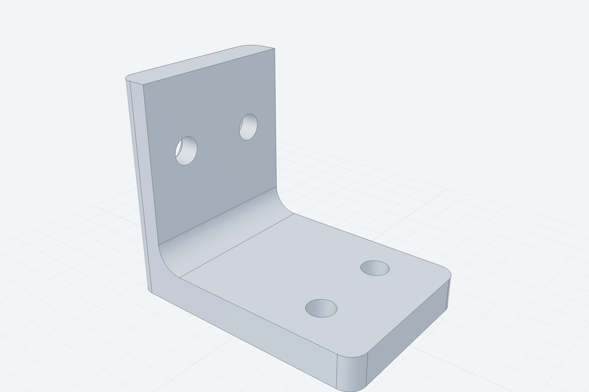
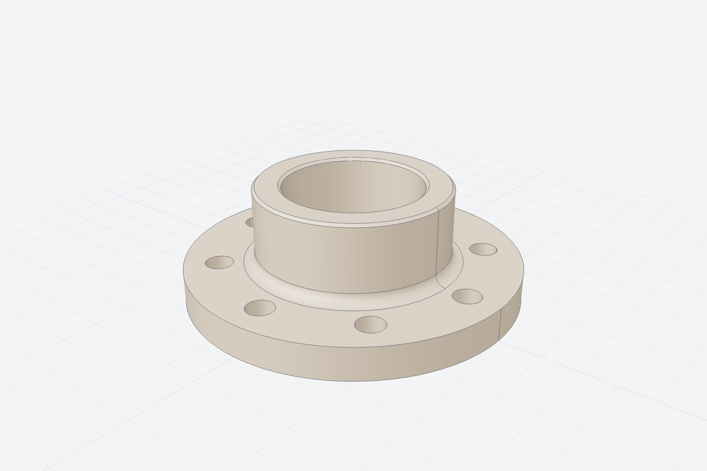
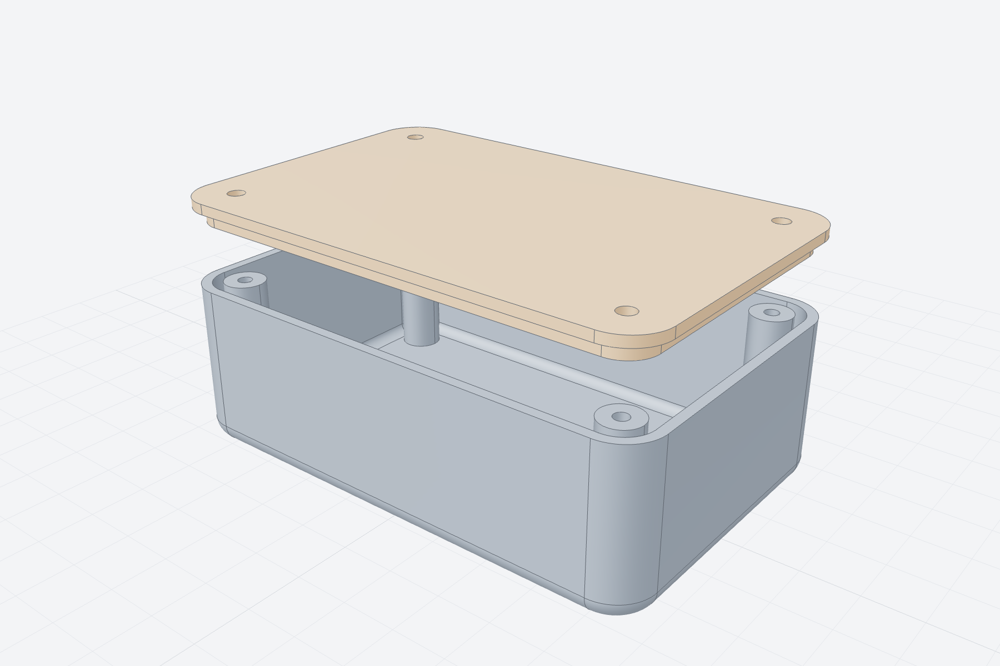
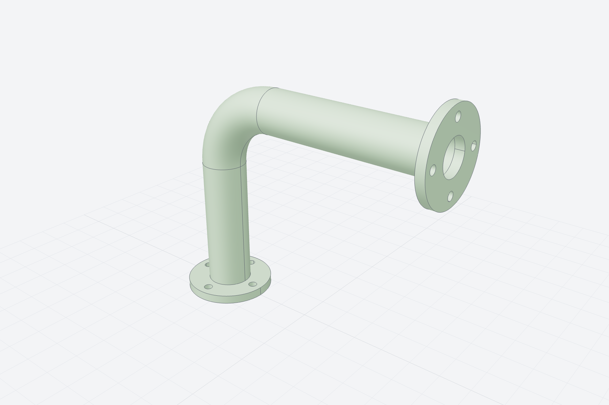
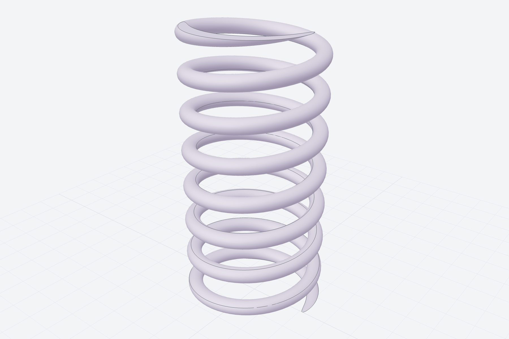
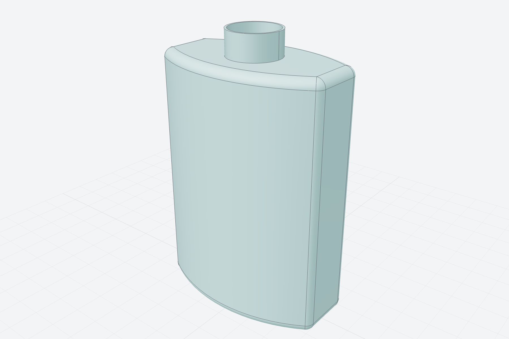
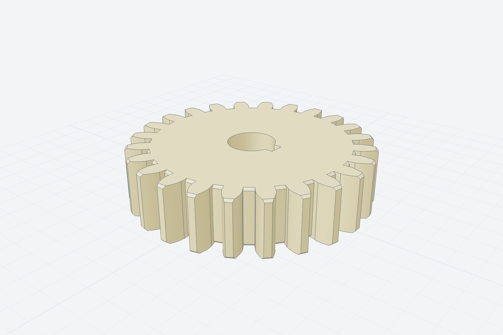
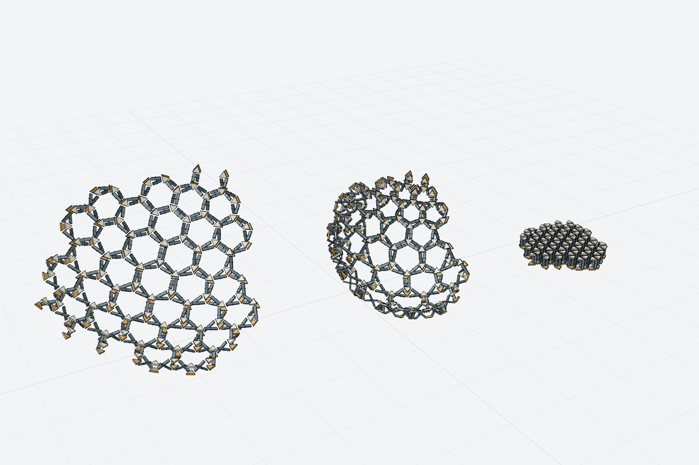

# Examples

Each example is a script in [`examples/`](https://github.com/awv-informatik/smlibpy/tree/main/examples) with a `model()` function. Run one to open the model in the viewer and write a STEP file:

```bash
python examples/flange.py
```

## Bracket

Mounting bracket: an L-profile extruded, with a rounded inner corner and holes in both flanges.



```py
from smlibpy import *


def model() -> Part:
    t = 8  # wall thickness
    profile = Polygon((0, 0), (60, 0), (60, t), (t, t), (t, 50), (0, 50))
    bracket = profile.on(Plane.front).extrude(-40)  # front plane faces -Y; extrude backwards

    bracket = bracket.fillet(bracket.edges().concave(), 6)
    vertical = bracket.edges().parallel_to(Z)
    bracket = bracket.fillet(vertical.min_by(X) + vertical.max_by(X), 4)  # round both ends

    base = bracket.faces().facing(Z).bottom()  # the base flange's top face at z = t
    upright = bracket.faces().facing(-X).one()
    bracket -= (GridLocations(24, 20, 1, 2) * Pos(8) * Hole(3.2, t)).on(base)
    bracket -= (GridLocations(20, 1, 2, 1) * Pos(0, 8) * CounterSinkHole(3.2, 6, t)).on(upright)
    return bracket.named("bracket").colored("#7c93b5")
```

## Flange

Pipe flange: a revolved cross-section with a bolt circle.



```py
from smlibpy import *


def model() -> Part:
    # half cross-section in the front plane (x = radius, y = height), revolved about Z
    section = Polygon((25, 0), (60, 0), (60, 12), (35, 12), (35, 40), (25, 40))
    flange = section.on(Plane.front).revolve(Z)

    flange -= PolarLocations(47.5, 8) * Cylinder(5, 30)
    flange = flange.fillet(flange.edges().concave(), 4)          # neck to plate
    flange = flange.chamfer(flange.faces().top().edges().circles(), 1)
    return flange.named("flange").colored("#b08e6c")
```

## Enclosure

Electronics enclosure: rounded box, shelled, with screw bosses and a matching lid.



```py
from smlibpy import *

C, MIN = Align.CENTER, Align.MIN


def model() -> ShapeList:
    w, d, h, wall = 100, 64, 32, 2
    box = RoundedRectangle(w, d, 8).extrude(h)
    box = box.fillet(box.faces().bottom().edges(), 4)
    box = box.shell(wall, box.faces().top())

    boss = Cylinder(4, h - wall, align=(C, C, MIN)) - Cylinder(1.4, h, align=(C, C, MIN))
    box += (GridLocations(w - 16, d - 16, 2, 2) * boss).translate(0, 0, wall)

    lid = RoundedRectangle(w, d, 8).extrude(wall)
    lip = RoundedRectangle(w - 2 * wall - 0.4, d - 2 * wall - 0.4, 6).extrude(-3)
    lid = (lid + lip) - GridLocations(w - 16, d - 16, 2, 2) * Cylinder(1.7, 20)
    lid = lid.translate(0, 0, h + 15)
    return ShapeList([box.named("box").colored("#5b6b7f"), lid.named("lid").colored("#d9925a")])
```

## Pipe

A bent pipe: a ring profile swept along a path of lines and arcs, with flanges at the ends.



```py
from smlibpy import *


def model() -> Part:
    r = 30  # bend radius
    path = Wire([
        Line((0, 0, 0), (0, 0, 60)),
        CenterArc((r, 60), r, 180, -90, plane=Plane.front),
        Line((r, 0, 60 + r), (r + 80, 0, 60 + r)),
    ])
    pipe = sweep(Circle(10) - Circle(8), path)

    flange = (Circle(20) - Circle(8) - PolarLocations(15, 4) * Circle(2)).extrude(4)
    start = flange.translate(0, 0, -4)
    end = flange.on(Plane((r + 80, 0, 60 + r), z_dir=(1, 0, 0)))
    return (pipe + start + end).named("pipe").colored("#79ad73")
```

## Spring

Compression spring: a circle swept along a helix, with ground ends.



```py
from smlibpy import *


def model() -> Part:
    coil = sweep(Circle(1.2), Helix(pitch=6, height=48, radius=10))
    coil = coil.split(Plane.XY.offset(1.2)).split(Plane.XY.offset(48 - 1.2), keep="below")
    return coil.named("spring").colored("#9d87c7")
```

## Bottle

The classic OpenCASCADE bottle, built with smlibpy.



```py
from smlibpy import *


def model() -> Part:
    width, thickness, height = 50.0, 30.0, 70.0

    # half of the base outline: a straight flank, an arc, another flank
    half = Wire([
        Line((-width / 2, 0), (-width / 2, -thickness / 4)),
        ThreePointArc((-width / 2, -thickness / 4), (0, -thickness / 2), (width / 2, -thickness / 4)),
        Line((width / 2, -thickness / 4), (width / 2, 0)),
    ])
    outline = half + half.mirror(Plane.XZ)

    body = make_face(outline).extrude(height)
    body = body.fillet(body.edges(), thickness / 12)

    neck = Cylinder(thickness / 4, height / 10, align=(Align.CENTER, Align.CENTER, Align.MIN)).translate(0, 0, height)
    bottle = body + neck
    bottle = bottle.shell(thickness / 50, bottle.faces().top())
    return bottle.named("bottle").colored("#6bb3b3")
```

## Gear

Involute spur gear with a bore and a keyway.



```py
import math

from smlibpy import *


def involute_tooth(module: float, teeth: int, pressure_angle: float = 20.0) -> Sketch:
    rp = module * teeth / 2                       # pitch radius
    rb = rp * math.cos(math.radians(pressure_angle))  # base radius
    ra = rp + module                               # tip radius
    rr = rp - 1.25 * module                        # root radius

    def involute(r: float) -> tuple[float, float]:
        t = math.sqrt(max((r / rb) ** 2 - 1, 0.0))
        return rb * (math.cos(t) + t * math.sin(t)), rb * (math.sin(t) - t * math.cos(t))

    # half tooth thickness at the pitch circle is a quarter of the circular pitch
    inv = lambda a: math.tan(a) - a  # noqa: E731
    half_angle = math.pi / (2 * teeth) + inv(math.radians(pressure_angle))
    start = max(rb, rr)
    pts = [involute(start + (ra - start) * i / 12) for i in range(13)]
    rot = lambda p, a: (p[0] * math.cos(a) - p[1] * math.sin(a), p[0] * math.sin(a) + p[1] * math.cos(a))  # noqa: E731
    right = [rot(p, -half_angle) for p in pts]
    left = [(x, -y) for x, y in reversed(right)]

    flank_r = Spline(*right)
    flank_l = Spline(*left)
    tip = ThreePointArc(right[-1], (ra, 0), left[0])
    root_r, root_l = (rr * 0.98, right[0][1] * rr / right[0][0]), (rr * 0.98, left[-1][1] * rr / left[-1][0])
    outline = Wire([Line(root_r, right[0]), flank_r, tip, flank_l, Line(left[-1], root_l), Line(root_l, root_r)])
    return make_face(outline)


def model(module: float = 2.0, teeth: int = 24, width: float = 12.0, bore: float = 10.0) -> Part:
    rr = module * teeth / 2 - 1.25 * module
    tooth = involute_tooth(module, teeth)
    profile = Circle(rr) + PolarLocations(0, teeth) * tooth
    profile = profile - Circle(bore / 2) - Rectangle(3, 3).translate(bore / 2, 0)
    gear = profile.extrude(width)
    gear = gear.chamfer(gear.edges().circles().filter(lambda e: e.radius > bore), 0.5)
    return gear.named("gear").colored("#d4b45a")
```

## Umbrella_chair

Umbrella chair: a potato shell (a lumpy, slightly oblong sphere with a hollow to sit in) as a flat-packed umbrella
mesh of scissor cells whose sliding joints set the arm lengths for an upright pod or a lounge dish; the two potatoes
and the one flat pack as solids, in mm.



```py
import numpy as np

from smlibpy import *

# An umbrella mesh (Ren et al., SIGGRAPH 2022) is a deployable sheet of cells: a rigid top plate and a rigid bottom
# plate, joined to each neighbor by a scissor pair, two elastic arms crossing at a pin (arm A from this cell's top plate
# to the neighbor's bottom plate, arm B the other way). Flat-packed, the arms stand vertical and neighboring plates are
# 2 LUG apart; pushing each cell's plates together swings the arms out and the sheet expands in its plane, more
# where the arms are longer, so the per-cell arm lengths set the sheet's metric and it deploys into a curved shape by
# itself (the top and bottom halves of the arms differ where the sheet bends: shorter on the concave side). The
# reconfigurable umbrella mesh (Kusupati et al., AAG 2023) adds sliding joints between arms and plates, so the active
# arm lengths can be re-set and one mesh deploys to several shapes. Here that is a chair: one flat-packed sheet whose
# cells are set either for an upright pod or for a lounge dish, two potatoes the sitter sits inside; the arms'
# elasticity is the seat's give. This example does the geometry only: the layout, the arm lengths from the two target
# potatoes (least squares on the pivot-to-pin distances), the three states as exact solids placed kinematically on the
# targets, and the numbers (the slides that change one state into the other, the misfit the arms absorb, the play the
# pins need). It does not compute the elastic equilibrium (the EPFL code does that): no claim that the shapes are
# equilibria.

# The layout plane (x, y), mm, holds a regular triangular grid; in polar coordinates rho, theta, theta = 0 points to the
# seat's front (the sitter's knees), pi up the back, +pi/2 to the sitter's left. A chair maps it onto its potato by the
# inverse stereographic projection onto a sphere of radius R, alpha = 2 atan(rho / K) from the hollow's center, plus a
# relief along the radius. The map is conformal, so the expansion a cell needs is the same in every direction, one
# number per cell, which is what a scissor cell can do (the EPFL pipeline flattens its domes this way); its scale,
# (2 R / K) / (1 + (rho / K)^2) surface mm per layout mm, is largest at the center: the center cells open the most, as
# the apex cells of the EPFL domes. The sitter faces +x and sits inside the hollow; the top plates face the sitter (the
# potato's pale flesh), the bottom plates are its skin. Every state stands on z = 0. A pair's pivots, bars and pin share
# one hinge axis, the mean of the shared edge as the two plates' frames map it; on a curved sheet the two differ by the
# axis twist (about a cell's holonomy), which the lugs absorb: the pivots then sit up to 0.18 mm off the plates'
# mid-planes in the pod. The cells follow the released design files of EPFL-LGG/UmbrellaMesh_release_v1
# (plate_edge_length 30, arm thickness 3 and width 5, rest heights 67-160 mm), scaled up for a chair.
R_UP, R_LOUNGE = 450.0, 900.0  # the spheres: the upright pod, the lounge dish (twice the pod: a shallow bowl to lie in)
HOLLOW = 25.0  # the pod's hollow center sits this far (deg) behind the sphere's bottom; FOOT places the dish's
FOOT = 5.0  # the dish's front rim stands this many deg before its sphere's bottom, raised like a deck chair's foot end
CHAIRS = ("upright", "lounge")  # the two deployed states; the third is the flat pack
OBLONG = {"upright": (0.0, 0.0, 1.0), "lounge": (np.cos(np.radians(35)), 0.0, np.sin(np.radians(35)))}  # the long axis
RELIEF = 0.12  # the potato is this much longer along u: h = RELIEF R (q . u)^2; 0.25 and doubled bumps misfit 4 %
BUMPS = ((50, 30, 0.025), (70, 160, -0.02), (45, -110, 0.03), (80, -40, -0.025))  # (alpha, theta deg, eps): bumps eps R
SIGMA = 0.55  # a bump's width, radians on the unit sphere
# alpha_max = 72.5 - 15 cos(theta) + 2.5 cos(2 theta) deg: 60 at the front, 70 at the sides, 90 up the back, plus lumps
RIM = (72.5, -15.0, 2.5)
E_MIN = 1.2  # the expansion of the pod's least opened cell, at its far rim: a flat pack must open everywhere
GRID = 100.0  # the layout's triangular grid edge: a cell is one triangle (the cell count does not depend on it)
PLATE = 45.0  # plate edge (the EPFL files: 30; 60 mm cells here misfit over 3 %)
T_PLATE = 8.0  # plate thickness
LUG = 11.0  # the hinge pivot stands this far outside the plate edge (a lug, not modeled): the pod's slides clear it
ARM_T = 6.0  # arm thickness: the direction it bends in, in the scissor plane
ARM_W = 16.0  # arm width, along the hinge axis
OFFSET = PLATE / 4  # each bar of a pair sits this far from the edge midpoint along the edge: 22.5 apart, 6.5 of air
# the deployed plate separation, mid-plane to mid-plane, in both chairs: above the EPFL minimum of 5 ARM_T, 30 mm
DEPTH = 40.0
PIN_R = 3.0  # X-pin radius
PIN_L = 2 * OFFSET + ARM_W + 4  # the pin spans both bars and 2 mm beyond each
RHO = PLATE / (2 * np.sqrt(3))  # plate inradius: center to edge midpoint
RHO_H = RHO + LUG  # center to hinge pivot
D0 = 2 * RHO_H  # rest-state distance of neighboring cell centers: their pivots coincide, the plates 2 LUG = 22 mm apart
SHRINK = PLATE / np.sqrt(3) + 6  # a cell's centroid is this far inside the rim: the plate's circumradius, a margin
STATE_Y = {"lounge": -1300.0, "upright": 0.0, "flat": 1300.0}  # where the states stand in the picture of all three
COLORS = {"top": "#e3d3ae", "bottom": "#b98a4b", "arm": "#5f6f73", "pin": "#2b2b2b"}  # flesh, skin, GFRP grey, steel
DENSITY = {"top": 0.65e-3, "bottom": 0.65e-3, "arm": 1.9e-3, "pin": 7.85e-3}  # g/mm3: birch plywood, GFRP, steel
STRAIN_MAX, PLAY_MAX = 0.03, 4.0  # the misfit the arms absorb (3 %) and the play the pins need (mm): the statement


def rim(theta: np.ndarray) -> np.ndarray:
    """The hollow's edge as the angle from its center, radians: 60 deg at the front, 70 at the sides, 90 up the back,
    with lumps of up to 10 deg so that no two sides match."""
    a, b, c = RIM
    lumps = 6 * np.sin(3 * theta + 0.7) - 4 * np.sin(5 * theta - 0.3)
    return np.radians(a + b * np.cos(theta) + c * np.cos(2 * theta) + lumps)


def maps() -> dict[str, tuple[float, float]]:
    """(R, K) of each chair's map. K_up puts E_MIN at the far rim (theta = pi) of the upright pod; K_lo keeps the
    map's scale at the layout's center, so the dish's center is as open as the pod's and its rim, on the bigger sphere,
    opens more: the dish is the fully extended state and the pod's rim cells are the ones that slide."""
    far = rim(np.pi)
    cell = GRID / (np.sqrt(3) * D0)  # a cell's expansion per unit of map scale: layout spacing over rest spacing
    k_up = 2 * R_UP * np.cos(far / 2) ** 2 * cell / E_MIN
    return {"upright": (R_UP, k_up), "lounge": (R_LOUNGE, k_up * R_LOUNGE / R_UP)}


def frame(state: str) -> tuple[np.ndarray, np.ndarray, np.ndarray]:
    """The potato's frame: c0 from the sphere's center to the hollow's center point (the sitter's sacrum), e1 the
    tangent there toward the seat's front, e2 sideways to +y (the sitter's left). The pod's hollow sits HOLLOW deg
    behind its sphere's bottom; the dish's front rim FOOT deg before its own, so the body reclines from the feet up."""
    if state == "upright":
        behind = np.radians(HOLLOW)
    else:  # the front rim's angle from the hollow's center, less FOOT
        (_, k_up), (_, k_lo) = maps()["upright"], maps()["lounge"]
        behind = 2 * np.arctan(k_up * np.tan(rim(0.0) / 2) / k_lo) - np.radians(FOOT)
    c0 = np.array([-np.sin(behind), 0.0, -np.cos(behind)])
    e1 = np.array([1.0, 0.0, 0.0]) - c0[0] * c0
    e1 /= np.linalg.norm(e1)
    e2 = np.cross(c0, e1)
    return c0, e1, e2 if e2[1] > 0 else -e2


def potato(state: str, x: np.ndarray, y: np.ndarray) -> np.ndarray:
    """The potato's points for layout points, the sphere's center at the origin: the sphere's point plus the relief
    along the radius, longer along u and four bumps fixed in the frame (the potato keeps its lumps in both chairs)."""
    radius, k = maps()[state]
    c0, e1, e2 = frame(state)
    alpha, theta = 2 * np.arctan(np.hypot(x, y) / k), np.arctan2(y, x)
    across = np.cos(theta)[:, None] * e1 + np.sin(theta)[:, None] * e2
    q = np.cos(alpha)[:, None] * c0 + np.sin(alpha)[:, None] * across
    h = RELIEF * radius * (q @ np.array(OBLONG[state])) ** 2
    for a, t, eps in BUMPS:
        a, t = np.radians(a), np.radians(t)
        d = np.cos(a) * c0 + np.sin(a) * (np.cos(t) * e1 + np.sin(t) * e2)
        h = h + eps * radius * np.exp(-np.sum((q - d) ** 2, 1) / (2 * SIGMA**2))
    return (radius + h)[:, None] * q


def frames(state: str, x: np.ndarray, y: np.ndarray) -> tuple[np.ndarray, ...]:
    """The potato's points at layout points and the frames of the plates there: x along the layout's x, z the normal
    inward (toward the sitter), y = z cross x along the layout's +y (central differences over 1 mm)."""
    eps = 0.5
    du = (potato(state, x + eps, y) - potato(state, x - eps, y)) / (2 * eps)
    dv = (potato(state, x, y + eps) - potato(state, x, y - eps)) / (2 * eps)
    points = potato(state, x, y)
    x_hat = du / np.linalg.norm(du, axis=1)[:, None]
    n = np.cross(du, dv)
    n /= np.linalg.norm(n, axis=1)[:, None]
    n[np.sum(n * points, 1) > 0] *= -1  # inward: toward the sphere's center
    return points, x_hat, np.cross(n, x_hat), n


def layout() -> dict:
    """The cells: the triangles of a grid of edge GRID (rows along x, odd rows shifted half a step) whose centroid lies
    SHRINK inside the upright pod's rim as its map draws it on the layout, rho = K tan(alpha_max(theta) / 2). Returns
    their centroids, their plates' corners (2D, about the centroid), the pairs (i, j) of cells sharing an edge, that
    edge's unit direction e (the hinge axis) and each cell's hinge point: the edge midpoint pushed out to its lug."""
    _, k = maps()["upright"]
    dy = GRID * np.sqrt(3) / 2
    span = np.arange(-7, 8)  # +-600 mm and more: the rim's layout radius is at most 516 mm
    points, index = [], {}
    for r in span:
        for c in span:
            index[r, c] = len(points)
            points.append(((c + (0.5 if r % 2 else 0.0)) * GRID, r * dy))
    triangles = []
    for r in span[:-1]:
        for c in span[:-1]:
            if r % 2 == 0:
                triangles.append((index[r, c], index[r, c + 1], index[r + 1, c]))
                triangles.append((index[r, c + 1], index[r + 1, c + 1], index[r + 1, c]))
            else:
                triangles.append((index[r, c], index[r, c + 1], index[r + 1, c + 1]))
                triangles.append((index[r, c], index[r + 1, c + 1], index[r + 1, c]))
    points, triangles = np.array(points), np.array(triangles)
    centroids = points[triangles].mean(1)
    rho, theta = np.hypot(centroids[:, 0], centroids[:, 1]), np.arctan2(centroids[:, 1], centroids[:, 0])
    inside = rho < k * np.tan(rim(theta) / 2) - SHRINK
    triangles, centroids = triangles[inside], centroids[inside]
    first, pairs, edges = {}, [], []
    for cell, (p, q, r) in enumerate(triangles):
        for a, b in ((p, q), (q, r), (r, p)):
            edge = (min(a, b), max(a, b))
            if edge in first:
                pairs.append((first[edge], cell))
                edges.append(edge)
            else:
                first[edge] = cell
    pairs, edges = np.array(pairs), np.array(edges)
    e = points[edges[:, 1]] - points[edges[:, 0]]
    e /= np.linalg.norm(e, axis=1)[:, None]
    mid = points[edges].mean(1)
    lugs = {}
    for name, cells in (("hinge_i", pairs[:, 0]), ("hinge_j", pairs[:, 1])):
        u = mid - centroids[cells]
        lugs[name] = centroids[cells] + RHO_H * u / np.linalg.norm(u, axis=1)[:, None]
    corners = (points[triangles] - centroids[:, None]) * (PLATE / GRID)
    return {"centroids": centroids, "corners": corners, "pairs": pairs, "mid": mid, "e": e, **lugs}


def place(mesh: dict, state: str) -> dict:
    """Where a state's plates are: its layout (the flat pack's is shrunk until the pivots of a pair coincide), the
    plates' mid-plane centers and frames (x, y in the plate, n its normal toward the sitter)."""
    centroids = mesh["centroids"]
    if state == "flat":  # the rest state: the arms vertical, each plate its rest half-arm from the pin plane z = 0
        scale = D0 * np.sqrt(3) / GRID
        layout = scale * centroids
        lug_i = lug_j = scale * mesh["mid"]  # the lug is rigid: both hinge points of a pair land on the shrunk midpoint
        x, y, n = (np.tile(axis, (len(centroids), 1)) for axis in np.eye(3))
        top, bottom = np.column_stack([layout, mesh["rest"]["top"]]), np.column_stack([layout, -mesh["rest"]["bottom"]])
    else:
        layout, lug_i, lug_j = centroids, mesh["hinge_i"], mesh["hinge_j"]
        surface, x, y, n = frames(state, centroids[:, 0], centroids[:, 1])
        top, bottom = surface + (DEPTH / 2) * n, surface - (DEPTH / 2) * n
    return {"layout": layout, "hinge_i": lug_i, "hinge_j": lug_j, "x": x, "y": y, "n": n, "top": top, "bottom": bottom}


def pivot(placed: dict, cells: np.ndarray, at: np.ndarray, layer: str) -> np.ndarray:
    """The 3D points of the layout points ``at`` on the ``layer`` plates of ``cells``: a plate is rigid, so a layout
    offset from its cell's centroid maps through the plate's frame, never through the surface."""
    d = at - placed["layout"][cells]
    return placed[layer][cells] + d[:, :1] * placed["x"][cells] + d[:, 1:] * placed["y"][cells]


def closest_points(p: np.ndarray, d: np.ndarray, q: np.ndarray, f: np.ndarray) -> tuple[np.ndarray, np.ndarray]:
    """The closest points of the lines p + t d and q + s f (unit d, f), rows at a time."""
    w = p - q
    df = np.sum(d * f, 1)
    wd, wf = np.sum(w * d, 1), np.sum(w * f, 1)
    t = (df * wf - wd) / (1 - df**2)
    return p + t[:, None] * d, q + (wf + t * df)[:, None] * f


def design() -> dict:
    """The mesh: the layout, the cells' plates on both chairs, and per chair the pins (where a pair's two centerlines
    cross: between the closest points of the skew lines) and the half-arm lengths that fit the pivot-to-pin distances
    (one top and one bottom half-arm per cell, its three arms alike: the mean over its pairs, the least-squares fit);
    then the rest half-arms that serve both chairs (the fabricated mesh) and the slides each chair needs."""
    mesh = layout()
    i, j = mesh["pairs"].T
    hinge_i, hinge_j = mesh["hinge_i"], mesh["hinge_j"]
    count = np.bincount(np.concatenate([i, j]), minlength=len(mesh["centroids"]))  # pairs per cell, 1 to 3
    mesh["placed"], mesh["pins"], mesh["active"] = {}, {}, {}
    for state in CHAIRS:
        placed = mesh["placed"][state] = place(mesh, state)
        top_i, bot_j = pivot(placed, i, hinge_i, "top"), pivot(placed, j, hinge_j, "bottom")
        top_j, bot_i = pivot(placed, j, hinge_j, "top"), pivot(placed, i, hinge_i, "bottom")
        d_a = (bot_j - top_i) / np.linalg.norm(bot_j - top_i, axis=1)[:, None]  # arm A's centerline
        d_b = (bot_i - top_j) / np.linalg.norm(bot_i - top_j, axis=1)[:, None]  # arm B's
        p, q = closest_points(top_i, d_a, top_j, d_b)
        mesh["pins"][state] = (p + q) / 2
        to_pin = np.concatenate([np.linalg.norm(p - top_i, axis=1), np.linalg.norm(q - top_j, axis=1)])
        from_pin = np.concatenate([np.linalg.norm(bot_j - p, axis=1), np.linalg.norm(bot_i - q, axis=1)])
        mesh["active"][state] = {
            "top": np.bincount(np.concatenate([i, j]), weights=to_pin, minlength=len(count)) / count,
            "bottom": np.bincount(np.concatenate([j, i]), weights=from_pin, minlength=len(count)) / count,
        }
    mesh["rest"] = {layer: np.max([mesh["active"][st][layer] for st in CHAIRS], axis=0) for layer in ("top", "bottom")}
    mesh["slide"] = {  # of a joint: what the rest half-arm has over this chair's active one; 0 where it needs it all
        st: {layer: mesh["rest"][layer] - mesh["active"][st][layer] for layer in ("top", "bottom")} for st in CHAIRS
    }
    return mesh


def geometry(mesh: dict, state: str, y: float = 0.0) -> dict:
    """Where everything of one state is: the plates' centers and frames, the bars' ends, lengths and misfits, the pins;
    shifted so that the lowest point stands on z = 0, and sideways by ``y``."""
    placed = mesh["placed"][state] if state in mesh["placed"] else place(mesh, state)
    i, j = mesh["pairs"].T
    e, rest = mesh["e"], mesh["rest"]
    axis_i = e[:, :1] * placed["x"][i] + e[:, 1:] * placed["y"][i]  # the shared edge as each plate's frame maps it
    axis_j = e[:, :1] * placed["x"][j] + e[:, 1:] * placed["y"][j]
    twist = np.degrees(np.arccos(np.clip(np.sum(axis_i * axis_j, 1), -1, 1)))  # between the two: the lugs absorb it
    hinge = axis_i + axis_j
    hinge /= np.linalg.norm(hinge, axis=1)[:, None]  # the pair's hinge axis: its pivots, its bars' width, its pin
    if state == "flat":
        active, slide = rest, {layer: 0 * rest[layer] for layer in rest}
        pin = np.column_stack([placed["hinge_i"], 0 * i])  # the pivots of a pair coincide there, the pin below them
    else:
        active, slide, pin = mesh["active"][state], mesh["slide"][state], mesh["pins"][state]
    geo = {key: placed[key] for key in ("top", "bottom", "x", "y", "n")}
    geo.update(hinge=hinge, pin=pin, slide=slide, twist=twist, bars={})
    lug_i, lug_j = placed["hinge_i"], placed["hinge_j"]
    # per bar: its top cell and hinge point, its bottom cell and hinge point, its offset along the hinge axis
    ends = {"a": (i, lug_i, j, lug_j, OFFSET), "b": (j, lug_j, i, lug_i, -OFFSET)}
    low = np.inf
    for bar, (top, at_top, bottom, at_bottom, offset) in ends.items():
        a = pivot(placed, top, at_top, "top") + offset * hinge
        b = pivot(placed, bottom, at_bottom, "bottom") + offset * hinge
        length = np.linalg.norm(b - a, axis=1)
        d = (b - a) / length[:, None]
        thick = np.cross(d, hinge)
        thick /= np.linalg.norm(thick, axis=1)[:, None]
        wide = np.cross(thick, d)  # the box's axes: length along d, width along the hinge axis, thickness across
        full = active["top"][top] + active["bottom"][bottom]  # pivot to pivot as designed for this state
        hole = a + active["top"][top][:, None] * d  # where the design drills the bar for the pin
        bar_rest = rest["top"][top] + rest["bottom"][bottom]  # the fabricated bar
        # the bar overshoots its pivots by the slides
        start, end = a - slide["top"][top][:, None] * d, b + slide["bottom"][bottom][:, None] * d
        geo["bars"][bar] = {
            "rest": bar_rest,
            "start": start,
            "end": end,
            "d": d,
            "strain": (length - full) / full,  # the misfit the elastic bar absorbs
            "play": np.linalg.norm(np.cross(hole - pin, hinge), axis=1),  # the hole's distance from the pin's axis
        }
        # a box's lowest point: its center less its half extents times the axes' rise
        drop = bar_rest / 2 * np.abs(d[:, 2]) + ARM_W / 2 * np.abs(wide[:, 2]) + ARM_T / 2 * np.abs(thick[:, 2])
        low = min(low, ((start + end)[:, 2] / 2 - drop).min())
    cells = np.repeat(np.arange(len(placed["layout"])), 3)
    at = (placed["layout"][:, None] + mesh["corners"]).reshape(-1, 2)
    drop = (T_PLATE / 2) * np.abs(placed["n"][cells, 2])  # a plate's lowest point: a corner, half its thickness down
    low = min([low] + [(pivot(placed, cells, at, layer)[:, 2] - drop).min() for layer in ("top", "bottom")])
    shift = np.array([0.0, y, -low])
    for key in ("top", "bottom", "pin"):
        geo[key] = geo[key] + shift
    for bar in geo["bars"].values():
        bar["start"], bar["end"] = bar["start"] + shift, bar["end"] + shift
    return geo


def build(geo: dict, mesh: dict, prefix: str) -> list[Part]:
    """The solids of one state from its geometry: ``prefix_top_12``, ``prefix_arm_12_15a``, ``prefix_pin_12_15``."""
    parts = []
    for k, corners in enumerate(mesh["corners"]):
        for layer in ("top", "bottom"):
            plane = Plane(origin=geo[layer][k], x_dir=geo["x"][k], z_dir=geo["n"][k])
            plate = Polygon(*corners).on(plane).extrude(T_PLATE / 2, both=True)
            parts.append(plate.named(f"{prefix}_{layer}_{k}").colored(COLORS[layer]))
    for k, (i, j) in enumerate(mesh["pairs"]):
        hinge = geo["hinge"][k]
        for bar, arm in geo["bars"].items():
            # The box has the bar's rest length and is centered between its overshot ends: it misses them by half the
            # misfit the elastic bar absorbs. Length along the bar, width along the hinge axis, thickness across the
            # bar in the scissor plane.
            d = arm["d"][k]
            plane = Plane(origin=(arm["start"][k] + arm["end"][k]) / 2, x_dir=d, z_dir=np.cross(d, hinge))
            box = plane * Box(float(arm["rest"][k]), ARM_W, ARM_T)
            parts.append(box.named(f"{prefix}_arm_{i}_{j}{bar}").colored(COLORS["arm"]))
        pin = Plane(origin=geo["pin"][k], z_dir=hinge) * Cylinder(PIN_R, PIN_L)
        parts.append(pin.named(f"{prefix}_pin_{i}_{j}").colored(COLORS["pin"]))
    return parts


def model(state: str = "all") -> ShapeList:
    """The chair: ``"all"`` gives the lounge dish (at y = -1300), the upright pod (y = 0) and the flat pack (y = +1300)
    side by side; ``"upright"``, ``"lounge"`` or ``"flat"`` gives that state alone, its middle at y = 0."""
    if state not in ("all", *STATE_Y):
        raise ValueError(f"state must be one of 'all', 'upright', 'lounge', 'flat', not {state!r}")
    mesh = design()
    states = list(STATE_Y) if state == "all" else [state]
    parts = []
    for name in states:
        parts += build(geometry(mesh, name, STATE_Y[name] if state == "all" else 0.0), mesh, name)
    return ShapeList(parts)


def clearance(a: np.ndarray, b: np.ndarray, directions: np.ndarray) -> float:
    """A lower bound of the distance between two convex solids from their vertices: the widest gap between their
    projections on ``directions`` (their face normals and edge directions) and on the pairwise cross products of those
    (the separating axis theorem). It is the distance itself where the nearest features are parallel, as they are
    between an arm and the plate it leaves, and never more than the kernel's ``distance_to``, which confirms the
    tightest pairs (and takes up to 0.5 s a pair here, where the nearest points form a segment)."""
    axes = np.vstack([directions, np.cross(directions[:, None], directions[None]).reshape(-1, 3)])
    axes = axes[np.linalg.norm(axes, axis=1) > 1e-9]
    axes /= np.linalg.norm(axes, axis=1)[:, None]
    pa, pb = a @ axes.T, b @ axes.T
    return float(max((pb.min(0) - pa.max(0)).max(), (pa.min(0) - pb.max(0)).max()))


def check(parts: ShapeList) -> None:
    """The numbers the kernel must find, worked out from the design: every plate, arm and pin has the volume and the
    center of its design, each state stands on z = 0, no arm touches a plate of its two cells or a bar of another pair
    at those cells, the flat pack is exact; then the cut list and the joint table."""
    mesh = design()
    pairs, corners = mesh["pairs"], mesh["corners"]
    n_cells, n_pairs = len(corners), len(pairs)
    by_state: dict[str, dict[str, Part]] = {}
    for part in parts:
        by_state.setdefault(part.name.split("_")[0], {})[part.name] = part
    offsets = STATE_Y if len(by_state) > 1 else dict.fromkeys(by_state, 0.0)
    plate_volume, pin_volume = np.sqrt(3) / 4 * PLATE**2 * T_PLATE, np.pi * PIN_R**2 * PIN_L
    sides = np.roll(corners, -1, axis=1) - corners  # the plates' edges, 2D
    rows = []
    for state, named in by_state.items():
        geo = geometry(mesh, state, offsets[state])
        assert len(named) == 2 * n_cells + 3 * n_pairs, (state, len(named))
        assert all(part.is_valid() for part in named.values()), state
        for k in range(n_cells):
            for layer in ("top", "bottom"):
                plate = named[f"{state}_{layer}_{k}"]
                assert abs(plate.volume - plate_volume) < 1e-9 * plate_volume, (plate.name, plate.volume)
                assert plate.center().distance_to(geo[layer][k]) < 1e-6, plate.name
        points = {name: np.array([v.point.to_tuple() for v in part.vertices()]) for name, part in named.items()}
        x, y, n = geo["x"], geo["y"], geo["n"]
        plate_axes = [np.vstack([n[c], sides[c, :, :1] * x[c] + sides[c, :, 1:] * y[c]]) for c in range(n_cells)]
        gaps = []  # (a lower bound of their distance, arm, plate) for every arm and the four plates of its two cells
        at_cell: list[list] = [[] for _ in range(n_cells)]  # the bars that meet at each cell, with their pair
        for k, (i, j) in enumerate(pairs):
            for bar, arm in geo["bars"].items():
                box = named[f"{state}_arm_{i}_{j}{bar}"]
                want = arm["rest"][k] * ARM_W * ARM_T
                assert abs(box.volume - want) < 1e-9 * want, (box.name, box.volume, want)
                assert box.center().distance_to((arm["start"][k] + arm["end"][k]) / 2) < 1e-6, box.name
                if state == "flat":  # fabricated: the bar stands vertical, exactly its rest length tall
                    along, across = abs(geo["hinge"][k, 0]), abs(geo["hinge"][k, 1])
                    size = box.bbox().size
                    assert abs(size.x - ARM_W * along - ARM_T * across) < 1e-6, box.name
                    assert abs(size.y - ARM_W * across - ARM_T * along) < 1e-6, box.name
                    assert abs(size.z - arm["rest"][k]) < 1e-6, box.name
                axes = np.vstack([arm["d"][k], geo["hinge"][k], np.cross(arm["d"][k], geo["hinge"][k])])
                for c in (i, j):
                    at_cell[c].append((k, box, axes))
                    for layer in ("top", "bottom"):
                        plate = named[f"{state}_{layer}_{c}"]
                        gap = clearance(points[box.name], points[plate.name], np.vstack([axes, plate_axes[c]]))
                        gaps.append((gap, box, plate))
            pin = named[f"{state}_pin_{i}_{j}"]
            assert abs(pin.volume - pin_volume) < 1e-9 * pin_volume, pin.name
            assert pin.center().distance_to(geo["pin"][k]) < 1e-6, pin.name
        crossings = []  # the same for bars of different pairs meeting at a cell (the pod's overshoots bring them close)
        for bars in at_cell:
            for m, (k1, box1, axes1) in enumerate(bars):
                for k2, box2, axes2 in bars[m + 1 :]:
                    if k1 != k2:
                        gap = clearance(points[box1.name], points[box2.name], np.vstack([axes1, axes2]))
                        crossings.append((gap, box1, box2))
        gaps.sort(key=lambda g: g[0])
        crossings.sort(key=lambda g: g[0])
        assert gaps[0][0] > 0 and crossings[0][0] > 0, (gaps[0], crossings[0])
        measured = {}  # the kernel's distance on the tightest pairs: never under the bound
        for gap, a, b in gaps[:6] + crossings[:3]:
            measured[a.name, b.name] = a.distance_to(b)
            assert gap - 1e-6 <= measured[a.name, b.name], (a.name, b.name, gap)
        bars = min(measured[a.name, b.name] for _, a, b in crossings[:3])  # the bound is loose for skew boxes
        boxes = np.array([[tuple(part.bbox().min), tuple(part.bbox().max)] for part in named.values()])
        low, size = boxes[:, 0].min(0), boxes[:, 1].max(0) - boxes[:, 0].min(0)
        assert abs(low[2]) < 1e-6, (state, low[2])  # the state stands on z = 0
        if state == "flat":  # neighboring plates of a layer are 2 LUG apart: the kernel measures a pair at one height
            rest_top = mesh["rest"]["top"]
            i, j = pairs[np.argmin(np.abs(rest_top[pairs[:, 0]] - rest_top[pairs[:, 1]]))]
            assert abs(named[f"flat_top_{i}"].distance_to(named[f"flat_top_{j}"]) - 2 * LUG) < 1e-6, (i, j)
        strain = np.concatenate([bar["strain"] for bar in geo["bars"].values()])
        play = max(bar["play"].max() for bar in geo["bars"].values())
        assert np.abs(strain).max() < STRAIN_MAX and play < PLAY_MAX, (state, np.abs(strain).max(), play)
        centers = (geo["top"] + geo["bottom"]) / 2
        between = (centers[pairs[:, 0]] - centers[pairs[:, 1]])[:, : 2 if state == "flat" else 3]
        spread = np.linalg.norm(between, axis=1) / D0
        slid = (geo["slide"]["top"] > 0.05) | (geo["slide"]["bottom"] > 0.05)
        slide = max(geo["slide"]["top"].max(), geo["slide"]["bottom"].max())
        rows.append(
            f"{state:8} {size[0]:4.0f} x {size[1]:4.0f} x {size[2]:3.0f}  {spread.min():.2f}-{spread.max():.2f}"
            f"  {100 * np.abs(strain).max():6.2f} / {100 * np.sqrt((strain**2).mean()):5.2f}  {play:7.2f}"
            f"  {geo['twist'].max():9.2f}  {slid.sum():4d}  {slide:8.2f}  {gaps[0][0]:6.2f}  {bars:7.2f}"
        )
    top, bottom = mesh["rest"]["top"], mesh["rest"]["bottom"]
    print(f"{n_cells} cells, {n_pairs} pairs; rest half-arms top {top.min():.1f}-{top.max():.1f} mm,", end=" ")
    print(f"bottom {bottom.min():.1f}-{bottom.max():.1f} mm; the pack's cell centers {D0:.2f} mm apart")
    print("state    size (mm)          expansion  misfit max/rms  play mm  twist deg  slid  slide mm  gap mm  bars mm")
    print("\n".join(rows))
    first = next(iter(by_state.values())).values()
    mass = {
        k: sum(p.mass_properties(density=d).mass for p in first if p.name.split("_")[1] == k)
        for k, d in DENSITY.items()
    }
    plates, arms, pins = (mass["top"] + mass["bottom"]) / 1000, mass["arm"] / 1000, mass["pin"] / 1000
    print(f"one chair: plates {plates:.2f} kg, arms {arms:.2f} kg, pins {pins:.2f} kg: {plates + arms + pins:.2f} kg")
    if {"upright", "lounge"} <= set(by_state):  # the joint table: how to re-set the chair, the largest slides first
        up, lo = mesh["slide"]["upright"], mesh["slide"]["lounge"]
        moved = np.maximum(np.abs(up["top"] - lo["top"]), np.abs(up["bottom"] - lo["bottom"]))
        n_moved, largest = np.sum(moved > 0.05), np.argsort(-moved)[:5]
        print(f"re-set {n_moved} of {n_cells} cells from pod to dish, slides up to {moved.max():.1f} mm;", end=" ")
        print("the five largest, cell: top / bottom (mm):")
        t1, t2, b1, b2 = up["top"], lo["top"], up["bottom"], lo["bottom"]
        notes = [f"{k}: {t1[k]:.1f}->{t2[k]:.1f} / {b1[k]:.1f}->{b2[k]:.1f}" for k in largest]
        print("  " + "   ".join(notes))
```
