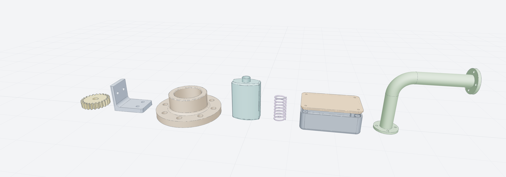

# smlibpy



A Python library for 3D modeling on the [SMLib NURBS kernel](https://github.com/NVIDIA-Omniverse/usd-brep).
It comes with an MCP server, so your agent can build parts too.

```python
from smlibpy import *

plate = Box(80, 60, 10)
plate = plate.fillet(plate.edges().parallel_to(Z), 8)
plate -= GridLocations(60, 40, 2, 2) * Cylinder(4, 10)
plate -= Rectangle(30, 20).on(plate.faces().top()).extrude(-4)

plate.export("plate.step")
show(plate)
```

Parts are B-reps with exact surfaces. You combine shapes with `+`, `-` and `&`, and every
feature returns a new part. Faces and edges are picked by their geometry, for example
`part.edges().parallel_to(Z).concave()`. Fillets can be circular, variable or G2/G3, and there
are shells, lofts, sweeps, freeform surfaces, stitching, intersections and mass properties.
STEP files are read and written with the exact geometry; meshes go to glTF and STL.

<div class="grid cards" markdown>

- **[Getting started](getting-started.md)**: install, a first part, the viewer.
- **[Concepts](concepts.md)**: shapes, planes, placement, patterns, selection.
- **[Sketches](sketches.md)** and **[parts](parts.md)**: from 2D profiles to solids.
- **[Features](features.md)**: fillets, chamfers, shells, splits.
- **[Selecting](selecting.md)**: every way to pick faces and edges.
- **[Surfaces](surfaces.md)**: freeform modeling and stitching.
- **[Measuring](analysis.md)** and **[files](files.md)**: mass properties, STEP, glTF.
- **[Examples](examples.md)**: brackets, flanges, gears, a bottle.
- **[The kernel](kernel.md)**: how smlibpy uses SMLib, accuracy and limits.

</div>
