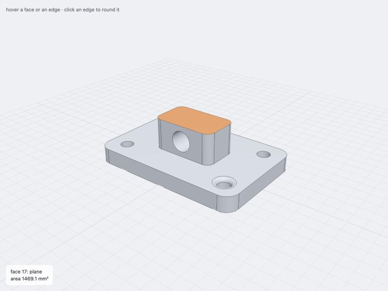

# smlibpy-three (draft)

smlibpy's CAD modeling API for three.js. Parts, sketches, faces, edges and curves are three.js
objects: a part is a `THREE.Mesh`, an edge a `THREE.Line`. They take and give three's types
(`Vector3`, `Matrix4`, `Plane`, `Ray`, `Box3`, `Shape`, `Curve`, `BufferGeometry`) in three's
coordinates and follow three's conventions: `new Box(80, 10, 60)` is the box
`THREE.BoxGeometry(80, 10, 60)` would be, cylinders stand along y as `CylinderGeometry`'s do, sketches
lie in the XY plane and extrude along +z as `ShapeGeometry` and `ExtrudeGeometry` do, angles are
radians. Underneath is smlibwasm (`@classcad/smlibwasm`, the SMLib kernel in WebAssembly); none of it
shows.

```js
import * as THREE from 'three'
import { Box, Cylinder, GridLocations, Hole, Locations, Rectangle, Y } from '@classcad/smlibpy-three'

let part = new Box(120, 12, 80, { align: { y: 'min' } }) // a THREE.Mesh, lying on the ground
part = part.fillet(part.edges().parallelTo(Y), 10)

const top = part.faces().top().one()
part = part.fuse(new Rectangle(50, 30, { fillet: 6 }).on(top).extrude(24)) // a sketch on the top face, extruded up

const [frame] = Locations(top) // the face's frame: its z is the face's normal
part = part.cut(new Hole(5, 20).at(GridLocations(90, 50, 2, 2).map((m) => frame.clone().multiply(m))))

const bore = new Cylinder(8, 8, 100) // along y, as THREE.CylinderGeometry(8, 8, 100)
bore.rotation.x = Math.PI / 2 // tools are placed with three's transforms
bore.position.y = 24
part = part.cut(bore)

scene.add(part)

const [hit] = raycaster.intersectObject(part) // three's Raycaster
hit.brep // the BrepFace that was hit (a THREE.Mesh); on part.edgeLines, the BrepEdge (a THREE.Line)
```



Status: a draft, not published. It wraps all of smlibwasm's public API as `next` has it (0.5.1:
what is left out, and why, is listed below, and `test/forms.test.ts` checks it name by name), with
191 tests (`npm test`) and an example page (`npm run example`). [API.md](API.md) is the API
reference; [WRAPPING.md](WRAPPING.md) says how a feature is wrapped.

## Using it

```bash
npm install
npm test           # node's test runner, on the TypeScript sources
npm run build      # dist/ with declarations that name nothing of smlibwasm's
npm run api        # API.md, the API reference, from the declarations (after a build)
npm run example    # the example page (Vite)
```

`@classcad/smlibwasm` is a dependency (here `file:../js`; build it first: `npm run wasm` and
`npm run build` in `js/`), `three` a peer (developed on 0.186.1). Importing the package loads the
kernel (a top-level await, 2.8 MB with brotli), and after that every call is synchronous.
`@classcad/smlibpy-three/init` loads the kernel from elsewhere (`init({ locateFile })`), and
`@classcad/smlibpy-three/worker` runs modeling functions in a worker (below). Vite's dev server must
leave smlibwasm out of its prebundling (`optimizeDeps: { exclude: ['@classcad/smlibwasm'] }`, see
`example/vite.config.ts`).

## Design

### Every shape is a three object

| smlibpy | here | extends |
|---|---|---|
| `Part`, `Box`, `Cylinder`, `Cone`, `Sphere`, `Hole`, ... | `Part` and its subclasses (`Box`, `Cylinder`, `Cone`, `Ball`, `Hole`, ...) | `THREE.Mesh` |
| `Shell`, `Sketch`, `Rectangle`, `Circle`, `Text`, ... | `Shell`, `Sketch` and its subclasses | `THREE.Mesh` (double sided) |
| the edges of a body, drawn | `body.edgeLines` (a child of the body) | `THREE.LineSegments` |
| `Face` | `BrepFace` | `THREE.Mesh` |
| `Edge`, `Line`, `Spline`, `Helix`, `CenterArc`, ... | `BrepEdge` and its subclasses (`Segment`, `Spline`, ...) | `THREE.Line` |
| `Wire`, `Polyline`, `FilletPolyline` | `Wire` and its subclasses | `THREE.Line` |
| `Vertex` | `BrepVertex` | `THREE.Points` |
| `Mesh` (triangles) | `TriangleMesh` | `THREE.Mesh` |
| `ShapeList` | `ShapeList` (an Array, with smlibpy's selectors) | `Array` |

A body's `geometry` is the tessellation of its exact B-rep: one geometry cut from one tessellation
of the whole body (faces share the points where they meet), vertices split per face, with the
kernel's normals of the exact surfaces (not averaged ones), and faces' own colors as vertex colors.
It is made when three first reads it (to render, raycast, measure with `Box3`): intermediate parts of
a modeling chain are never tessellated. `part.tolerance` (chord height) and `part.angle` set how
fine; clones share one tessellation, as three's clones share their geometry. The material is any
three material; the default is a `MeshStandardMaterial` pushed back with `polygonOffset` so the edge
lines show (an app material without it hides them). They behave as any Object3D: `scene.add`,
`position`, `rotation`, `scale`, `layers`, `visible`, `clone()`, `copy()`, `toJSON()` (plain Mesh
and LineSegments that ObjectLoader reads back), three's renderers, `Box3.setFromObject`, three's
GLTFExporter and STLExporter for the tessellation. Classes keep three's `type` ('Mesh', 'Line', ...)
and add flags (`isPart`, `isBody`, `isBrepFace`, `isBrepEdge`, ...). No export shares a name with
three's (core or addons): smlibpy's `Line`, `Sphere`, `Triangle`, `Font`, `Face`, `Edge` and `Vertex`
are `Segment`, `Ball`, `TriangleSketch`, `OpenTypeFont`, `BrepFace`, `BrepEdge` and `BrepVertex` here.

### three's coordinates, three's geometries

The kernel works in three's coordinates: a point (x, y, z) is the kernel's (x, y, z), and there is no
axis change anywhere. Where smlibpy assumes Z up, the package follows three instead:

- **Solids take three's geometries' arguments**, defaults and placement (without their segment
  counts: the solids are exact; a number where the options go is a TypeError):

  | three | here |
  |---|---|
  | `BoxGeometry(width, height, depth)` | `new Box(width, height, depth)` |
  | `CylinderGeometry(radiusTop, radiusBottom, height, …, thetaStart, thetaLength)` | `new Cylinder(radiusTop, radiusBottom, height, { thetaStart, thetaLength })` |
  | `ConeGeometry(radius, height, …, thetaStart, thetaLength)` | `new Cone(radius, height, { thetaStart, thetaLength })` |
  | `SphereGeometry(radius, …, phiStart, phiLength, thetaStart, thetaLength)` | `new Ball(radius, { phiStart, phiLength, thetaStart, thetaLength })` |
  | `TorusGeometry(radius, tube, …, arc)` | `new Torus(radius, tube, { arc })` |
  | `RingGeometry(innerRadius, outerRadius, …, thetaStart, thetaLength)` | `new AnnularSector(innerRadius, outerRadius, height, { thetaStart, thetaLength })` |

  Cylinders and cones stand along y, a ball's poles are on y, a torus and a ring lie in the XY
  plane, each centered as three centers it and turned as three turns it (a sector of a cylinder runs
  from +z towards +x, as `CylinderGeometry`'s). `Pyramid` and `Wedge` take a box's
  `(width, height, depth)` and stand along y; `Hole` drills along -z into a face (below). `align`
  moves a solid by its bounding box (`{ y: 'min' }` stands it on the XZ plane).
- **2D is the XY plane**, as three's 2D shapes and curves are: sketches lie in it and face +z
  (`ShapeGeometry`), extrude along +z (`ExtrudeGeometry`) and revolve about y (`LatheGeometry`); a
  sketch's own (x, y) is three's (x, y). Arcs, ellipses, spirals and the pen of `Profile` turn
  counterclockwise seen from +z (`EllipseCurve`), text reads along +x seen from the front, a helix
  rises along +z (three's `HelixCurve`). Patterns (`GridLocations`, `PolarLocations`), flat patterns of
  sheet metal, drawing views, DXF and SVG lie in the XY plane too.
- **A face's frame has its z along the face's normal**, as a sketch on it lies: `sketch.on(face)`
  draws on the face, `Locations(face)` gives frames there, and a `Hole` placed at one drills into the
  face. A cylinder (along y) stands on a face once turned (`cylinder.rotation.x = Math.PI / 2`).
- **Directions are three's**: `top()` is the highest along +y, `front()` the nearest along +z
  (towards three's default camera), `right()` along +x. Deformations twist, taper and unroll about y
  and bend toward +y by default. Pictures' named views look as they say in a three scene ('top' from
  +y, 'front' from +z).
- **Files are read and written as they are**, as three's STLLoader and OBJLoader take files: a file's
  coordinates are three's. CAD files are mostly Z up: stand what a loader gives in a Y-up scene with
  `group.rotation.x = -Math.PI / 2`, as three's loaders turn assets that say they are Z up. USD says
  so: `USDBrepLoader` turns a Z-up stage that way, as three's own USDLoader does, and
  `USDBrepExporter` writes a Z-up stage of what the scene shows.

### three's types in and out

| smlibpy | here |
|---|---|
| `Vector` (points, directions) | `THREE.Vector3` (or any `{ x, y, z }`); results are new Vector3s, or fill a `target` |
| sketch coordinates | `THREE.Vector2`, and `THREE.Shape`, `THREE.Path` (with holes): `new Sketch(shapes)` |
| `Location`, `Pos`, `Rot` | the object's transform; `THREE.Matrix4` where a placement is an argument |
| `Locations`, `GridLocations`, ... | `THREE.Matrix4[]`; `shape.at(locations)` gives clones placed there |
| `Plane` | `THREE.Plane` (split, section, mirror, `face.plane`); a `Matrix4` where a frame is meant (`frame`) |
| `Axis` | `THREE.Ray` (revolve, fold, `face.axis`, deformation axes) |
| `BoundBox` | `THREE.Box3` |
| `X`, `Y`, `Z` | three's axes as frozen Vector3s: `Y` is up |
| curves as arguments (paths, rails, outlines) | `BrepEdge`, `Wire`, or any `THREE.Curve<Vector3>` |
| `Mesh` (triangles) | `TriangleMesh`; from any `THREE.BufferGeometry` (also by assigning one to its `geometry`), and `new Part(geometry)` makes a body of a closed one |
| `NurbsSurface` data | plain data, or three's `NURBSSurface` (addons) |
| degrees | radians, as everywhere in three |
| `import_step`, `to_step`, ... | loaders (`THREE.Loader`: `load`, `loadAsync`, `parse`) and exporters (`parse`) |
| `MassProperties`, `DraftAnalysis`, `Bend`, ... | the package's records, in three's types |
| `ModelingError`, `KernelError`, `FontError` | the package's own, with the same fields, in the package's words |

three's curves become exact kernel curves: lines, arcs and ellipses (with three's angles, direction
and rotation), quadratic and cubic Béziers as the same curves, and Catmull-Rom splines
(`SplineCurve`, `CatmullRomCurve3` of all three types) as B-splines that run exactly where three's
run: each segment of three's is a cubic Hermite curve, so a Bézier curve. Other curves (an app's own
subclass) are fitted through points. So an SVG (`SVGLoader.createShapes`) or a font
(`Font.generateShapes`) becomes an exact sketch where three's ShapeGeometry would lie, and a solid.
The other way, `edge.curve` is a `THREE.Curve` along the exact edge:
`new THREE.TubeGeometry(edge.curve, 64, 1)`.

### Placement

- Coordinates are in the object's own frame, as a geometry's are: what a query gives (`center()`,
  `bbox()`, `pointAt()`, `normalAt()`) and what a method takes (a point, a direction, a
  `THREE.Plane`, a `THREE.Curve`) is in the frame of the object it is called on.
- Shapes given to an operation are taken where they are in the world (their `matrixWorld`), as
  `object.attach()` keeps an object where it is: a tool moved with `tool.position.x = 10`, turned with
  `tool.rotation.y`, scaled, or placed in a group, cuts there (`TransformControls` on a tool, then
  `part.cut(tool)`). Scales go to the kernel too (a scale different per axis makes B-splines of the
  faces).
- The result is in the frame of the object the operation is called on and has its transform, name,
  flags and material, as its `clone()` would: it takes the original's place in the scene graph, also
  in a group. (A sheet or sketch made from a part keeps its own, two-sided material.) A free
  function's first shape plays that object.
- A body's faces, edges and vertices are where the body is.

### One API: methods and functions

The package follows the repository's rules for the API (AGENTS.md), as smlibpy and smlibwasm do:

- **Every operation of a body is a method and a function.** `part.draft(faces, angle, plane)` is
  `draft(part, faces, angle, plane)`: the function has the method's name and parameters, takes the
  body first, gives what the method gives (in the body's frame, with its transform), and is a
  TypeError, saying what it takes, for a shape it does not take. `fillet`, `chamfer` and
  `filletPreview` take the edges and find their part. Two names are three's: `scale` is a function
  only (an object's `scale` is its transform) and `outline` a method only (three's TSL has an
  `outline`).
- What stays a method: selections and topology (`faces()`, `top()`), measuring and checking
  (`bbox`, `classify`, `check`), placing (three's transforms, `at`, `on`), representations (`toMesh`,
  `toNurbs`). What stays a function: what makes a shape of several (`loft`, `blend`, `network`,
  `fitCurve`), files (loaders and exporters), pictures (`render`).
- **Parameters are named in full** (`tolerance`, `angleTolerance`), **choices are typed**
  (`corners: 'round' | 'sharp'`), every export has a doc comment, and modules are named as
  smlibwasm's (`deformations`, `pictures`), never after a function they hold.

### Values and objects

Operations return new objects and leave their inputs as they were, as smlibpy's do
(`part.fillet(...)` is a new part). What is three's (transform, material, visibility, children) is
changed in place as on any object. A parametric rebuild makes a new part and puts it where the old
one was (the example does it on a click), or copies it into the old object as three copies objects:
`part.copy(scope(() => model(params)))`. Each face, edge and vertex is one object per body, made when
first asked for: `part.faces()[3]` is the same object every time, and the one a raycast hit gives.

### Picking: three's Raycaster

There is no picking API of the package's own. A body's `raycast` is three's `Mesh.raycast`, and on
each intersection it sets `intersection.brep` to the face that was hit; the body's `edgeLines` are
three's `LineSegments` (hit within `raycaster.params.Line.threshold`, in world units, as three hits
lines) and set the edge. Everything else on the intersection is three's, and three's rules hold
(layers, recursion, invisible objects are hit). `brep` is one key, which survives R3F's spreading of
intersections into its events (`e.brep`) and collides with no DOM event property. The face of a hit
is found from the hit triangle's vertex (vertices are split per face), so it stays right whatever
order a BVH puts the triangles in. The kernel's exact ray cast is `body.intersectRay(ray)`.

A face, edge or vertex of a body draws itself: add it as a child of its body and it shows in place,
in its own highlight material (`part.add(hit.brep)`; remove it again to clear the highlight). These
children are not raycast, so they do not hit twice. Lines are drawn as three draws them, one pixel
wide; fat lines or tubes for highlights are the app's choice (the example draws a tube along
`edge.curve`).

### Disposal and memory

`dispose()` frees what the object made: its tessellation (once no clone draws it), its own default
materials, and its kernel body (once no clone holds it), and fires three's `'dispose'`. A material
assigned to it is the app's, as with any three object. A disposed body stays in the scene as it was
drawn (three uploads a disposed geometry again); modeling with it throws. Without `dispose()` the
garbage collector frees the kernel's bodies (smlibwasm's FinalizationRegistry), between tasks of the
event loop. In a loop that does not return to the event loop, `scope(fn)` disposes what `fn` made
and its result does not hold.

### Off the main thread

Kernel calls are synchronous. `@classcad/smlibpy-three/worker` runs modeling functions in a worker
(`expose` there, `new KernelWorker(...)` here), on smlibwasm's transport: bodies cross as their exact
kernel bodies with their transform, name and settings, faces and edges as their body and index,
curves, meshes, groups and three's math types as themselves; materials stay on their thread (their
color and name cross). A body coming back brings its tessellation, made in the worker, so the page
only uploads it to the GPU: tessellating is the slow step of drawing a large part. A call can time
out or be aborted; a crash or a timeout ends the worker, and the next call starts a new one.

### smlibwasm, hidden

`src/kernel.ts` imports smlibwasm and converts everything that crosses: values, angles, and errors
(the package's own `ModelingError`, `KernelError` and `FontError`, without the kernel's error as a
cause). The kernel's messages and warnings come in the package's words: its classes by the package's
names, `on()` where it says `.on(Plane.front)`, angles in radians ("between -π and π radians").
Kernel values live in per-object state under a symbol, not in properties. The build strips the
helpers the modules share (`@internal`) from the declarations and checks that no declaration names
smlibwasm (`scripts/declarations.mjs`); an app type-checks against the declarations without
smlibwasm installed, and a test checks that nothing reachable from the results is one of smlibwasm's
classes.

The package needs one function smlibwasm did not export: `faceMeshes` (smlibpy's
`smlibpy.mesh.face_meshes`, one mesh per face cut from one tessellation of the body), now exported
from `@classcad/smlibwasm` on this branch.

## Decisions

The draft's open questions, as they were decided:

1. **The name**: `@classcad/smlibpy-three`.
2. **three's coordinates and arguments**: no axis change (it was three's (x, y, z) = the kernel's
   (x, -z, y)), and the solids take three's geometries' arguments (`Box(width, height, depth)`, not
   smlibpy's `Box(length, width, height)` with its height up).
3. **The sketch plane**: XY, extruding along +z, as `ShapeGeometry` and `ExtrudeGeometry`.
4. **Radians**, as three.
5. **Results as three's methods make objects**: an operation's result is what `clone()` gives (the
   receiver's transform, name and material), with the operands taken where they are in the world, as
   `attach()` takes an object. (three-bvh-csg's `evaluate()`, a function of brushes, gives results in
   world space with an identity transform instead; a method of the receiver keeps its frame, so a
   part in a group, as STEPLoader gives assemblies, stays where it was.)
6. **`intersection.brep`** stays the key of the hit face or edge.
7. **Edges are picked as three picks lines**: within `raycaster.params.Line.threshold`, in world
   units (an app that wants pixels sets it from the camera, as the example does).
8. **The kernel's messages are translated** (see above).
9. **Faces, edges and vertices stay Object3Ds**: made when first asked for, one per sub-shape, they
   draw themselves as highlights and are what a raycast gives.
10. **Updating in place is `copy()`**, three's own: `part.copy(next)` takes `next`'s body and
    transform.
11. **Workers bring tessellations**: a body that comes back from a worker is drawn without being
    tessellated again. Subclasses arrive as their base class (a `Box` as a `Part`), as results of
    operations are.
12. **Option names follow their types**: bend's frame and DXFExporter's drawing frame are `frame`
    (a `THREE.Matrix4`; smlibpy calls them `plane`, which is a `THREE.Plane` here).
13. **Files**: `DXFLoader` gives a `THREE.Group` (of one sketch, or of wires with `wires: true`), as
    every loader gives one type; STEP coordinate systems are named empties (`THREE.Object3D`); SMB and
    SMP write the kernel's text form by default.
14. **Triangle meshes**: `new TriangleMesh(bodies)` takes the bodies where they are in the world (a
    constructor has no receiver), `tessellate(bodies)` in the first body's frame (a free function's
    first shape is its receiver); a geometry assigned to a mesh is its mesh, as a `THREE.Mesh`'s
    geometry is its shape.
15. **No name clashes with three** (see the renames above).
16. **Thin lines** are the app's choice.
17. **three only for now**: R3F typings, hooks or components come later.

## Coverage

All of smlibwasm's public API as `next` has it, by area ([API.md](API.md) has every signature):

| area | what |
|---|---|
| Shapes | `Part`, `Shell`, `Sketch`, `BrepFace`, `BrepEdge`, `Wire`, `BrepVertex`, `ShapeList`: every member but placement (Booleans, fillets, chamfers, shells, offsets, splits, sections, cells, imprints, slices, removing fillets and faces, drafts, direct face edits, sheet trims and blends, curve edits, NURBS data, face colors and names, all the selectors) |
| Solids | `Box`, `Cylinder`, `Cone`, `Ball`, `Torus`, `Wedge`, `Pyramid`, `AnnularSector`, `Hole`, `CounterBoreHole`, `CounterSinkHole`; `new Part(bufferGeometry)` |
| Sketches and text | `Rectangle`, `RoundedRectangle`, `Circle`, `Ellipse`, `Polygon`, `RegularPolygon`, `TriangleSketch`, `Trapezoid`, `Slot`, `ArcSlot`, `Stroke`, `Hull`, `makeFace`, `Text`, `new Sketch(threeShapes)`, `Profile`, `OpenTypeFont`, `loadFont`, `DEFAULT_FONT` |
| Curves | `Segment`, `PolarLine`, `Polyline`, `FilletPolyline`, `CenterArc`, `ThreePointArc`, `RadiusArc`, `SagittaArc`, `TangentArc`, `EllipticalArc`, `ParabolicArc`, `HyperbolicArc`, `ConicArc`, `Spline`, `Bezier`, `Helix`, `Spiral`, `fitCurve`, `makeCompatible`, `BrepEdge.fromNurbs`, `new BrepEdge(threeCurve)`, `new Wire(edges or curvePath)` |
| Operations and patterns | every operation of a body as a function too: `fuse`, `cut`, `intersect`, `xor`, `fillet`, `chamfer`, `filletPreview`, `shell`, `offset`, `mirror`, `scale`, `split`, `merge`, `section`, `thicken`, `imprint`, `draft`, `moveFaces`, `offsetFaces`, `removeFaces`, `removeFillets`, `push`, `warp`, `flatten`, `extend`, `trim`, `matchEdge`, `mergeFaces`, `project`, `silhouette`, `intersectionCurves`, `partingLine`, `slices`; the sweeps `extrude`, `revolve`, `sweep`, `loft`, `swing` (solids of sketches, sheets of curves); `GridLocations`, `PolarLocations`, `HexLocations`, `Locations`; `TOLERANCE`, `ACCURACY`, `X`, `Y`, `Z` |
| Measurements | `MassProperties`, `SectionProperties`, `DraftAnalysis`, closest points, curvature, continuity, exact ray hits, checks, `info` |
| Deformations | `twist`, `taper`, `bend`, `unroll`, `deform` (of parts, sheets, curves and points), `Lattice` |
| Surfaces | `surface`, `nurbsSurface`, `ruled`, `stitch`, `surfaceFillet`, `blend`, `fill`, `network`, `FitReport`, `StitchReport` |
| Sheet metal | `fold`, `flange`, `bends`, `unfold`, `flatPattern`, `Bend`, `FlatPattern`, `bendAllowance`, `bendDeduction`, `developedLength` |
| Triangle meshes | `TriangleMesh` (mesh Booleans, decimation, repair, sections and slices, `toPart`, exact rays), `tessellate`, `body.toMesh()` |
| Files | STEP (bodies, curves, points, coordinate systems), IGES (reading), DXF, SVG (writing), USD (`USDBrepLoader`, `USDBrepExporter`: usd-brep's exact bodies), OpenCASCADE BREP, SMLib SMB and SMP; `drawingViews` |
| Pictures | `render` (a PNG without a GPU), `diffImages`, `VIEWS` |
| Memory and settings | `scope`, `memoryUsage`, `setWarningHandler`, `setGuardSeconds`, `setGuardBooleans` |
| Entries | `@classcad/smlibpy-three/worker` (`KernelWorker`, `expose`), `@classcad/smlibpy-three/init` |

Left out, and why:

- smlibwasm's value classes (`Vector`, `Axis`, `Location`, `Plane`, `BoundBox`, `Pos`, `Rot`, `Hit`,
  `Nurbs`, ...): three's types stand in for them, and the package's records for its results.
- `translate`, `rotate`, `moved` and `Locations.mul`: placement is three's transforms (`position`,
  `rotation`, `scale`, `applyMatrix4`) and `shape.at(locations)`; scaling a body itself is the
  function `scale(shape, factor)`. A face, edge or vertex of a body is where its body is: it is not
  placed or mirrored on its own (`face.toShell()` is a sheet of it), and has no faces, edges or
  vertices of its own kind (it is one).
- Members under names three's objects have: smlibpy's `raycast` is `intersectRay` (three's
  `raycast` keeps its protocol), `Edge.add`/`Wire.add` is `new Wire([a, b])`, a mesh's `length` is
  `triangleCount`, `mesh` is `toMesh` (a curve's mesh: its polyline geometry), a whole body's
  `named`/`colored` is its object's `name` and material (faces: `nameFaces`, `colorFaces`), and the
  function `outline` is three's (a TSL node): call the method.
- The viewer (`show`, `htmlPage`): three is the viewer.
- Mesh formats (STL, OBJ, glTF/GLB): three's own loaders and exporters do them; a body is a Mesh,
  and a `TriangleMesh` is made of any BufferGeometry.
- Node path functions (`exportStep`, `importStep`, `readStep`, `save`, `load`, `Shape.export`,
  `Picture.save`): loaders take URLs and bytes, exporters give text or bytes.
- The raw kernel layer (`@classcad/smlibwasm/kernel`): no stable API, and it would show smlibwasm.
- IGES export and binary USD: smlibwasm has none either. render's `annotate`: it labels the
  kernel's stage, not three's axes. A mesh's kernel arrays: its geometry is their three view.

## Layout

| | |
|---|---|
| `src/kernel.ts` | the boundary: smlibwasm, values, angles, errors and their words |
| `src/convert.ts` | three's curves and 2D shapes as exact kernel curves |
| `src/tessellation.ts` | faces and edges as three geometries |
| `src/shapes.ts` | `Body`, `Part`, `Shell`, `Sketch`, `EdgeLines`, `BrepFace`, `BrepEdge`, `Wire`, `BrepVertex`, `ShapeList` |
| `src/properties.ts` | the records of measurements and checks |
| `src/primitives.ts` | the solids, as three's geometries |
| `src/sketches.ts`, `src/curves.ts`, `src/profiles.ts`, `src/font.ts` | sketches and text, curves, Profile, fonts |
| `src/operations.ts` | every operation of a body as a function, the sweeps, patterns and constants |
| `src/deformations.ts`, `src/surfaces.ts`, `src/sheetmetal.ts` | deformations, surfaces, sheet metal |
| `src/mesh.ts`, `src/pictures.ts` | triangle meshes, pictures (and the stage render and drawings draw on) |
| `src/files.ts`, `src/drawing.ts` | loaders and exporters, drawing views |
| `src/memory.ts`, `src/worker.ts`, `src/init.ts` | scope and settings, the worker entry, the init entry |
| `scripts/` | the declarations check, the API reference |
| `test/` | one file per area; `forms.test.ts` holds the API to smlibwasm's, name by name |
| `example/` | a three.js page: a part, a raycast hover, click an edge to round it |
